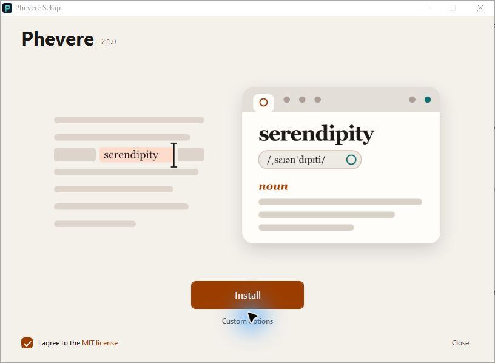
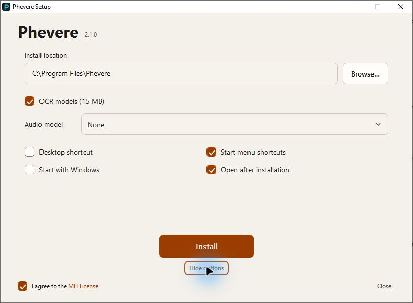

# Packaging & releases

2026-10-25: Linux packages. `npm run make:linux:x64` / `make:linux:arm64` build a deb, an rpm and an AppImage per arch (`scripts/make-linux.js`, one maker at a time to save memory). Releases build them on Ubuntu 22.04 runners. See the Linux section below.

2026-10-14: Windows Setup keeps the illustrated single-page layout and uses native, keyboard-accessible controls. Custom options include the installation folder, OCR, pronunciation models, shortcuts, startup, and opening the app after installation. A selected pronunciation model downloads during setup; Windows ARM64 omits this choice.



Custom options replace the illustration within the same window.



2026-10-14: Windows replacement installs reuse the recorded installation folder and preserve the notebook and settings. Custom folders retain their full path, including spaces. Optional shortcuts and OCR choices carry over, including choices made with older installers. Each Windows release job tests a real upgrade before replacing the download.

```mermaid
flowchart LR
  A[Existing Setup.exe] --> B[Recorded installation folder]
  B --> C[Saved notebook and settings]
  C --> D[Replacement Setup.exe]
  D --> E[Same folder and component choices]
  E --> F[Verify SQLite row and localStorage]
  F --> G[Current build in custom folder]
  G --> H[Same-version replacement]
  H --> I[Replace release download]
```



The release check upgrades the published installer at its actual recorded path. If the older installer uses a different folder, the check then uninstalls it and installs the current build in a custom folder with spaces while keeping the notebook and settings. It replaces the same version while the app is running and verifies that normal uninstall keeps user data. It runs only on a fresh administrator GitHub Windows runner; it refuses a developer machine or an existing installation.

**2026-09-30:** Windows Setup introduced the illustrated single-page layout. Art comes from `scripts/installer-art.js` through `prepare:installer`.

**2026-09-30:** Packages carry the speech engines in `resources/speech` (staged by `scripts/stage-speech.js` at prePackage): eSpeak NG WebAssembly (GPL-3.0, with its licence and source note), the bundled speech worker, and sherpa-onnx for Kokoro where a binary exists (not Windows on ARM). About 41 MB.

**2026-09-16:** `ci.yml` uploads an Android APK and an iOS IPA as Actions artifacts. They are not GitHub Release assets. Desktop `release.yml` is unchanged.

**2026-09-05:** `release.yml` Mac asset-delete is the same PowerShell as Windows (`scripts/gh-delete-release-asset.ps1`). CI Windows now runs `verify-ocr-pack` on the unpackaged app like macOS.

**2026-09-04:** Packaged app includes `speak_ipa_host.ps1` (long-lived System.Speech for IPA chips) and `speak_ipa.ps1`. **1.5.0** ships Windows Setup and macOS DMGs from the same tag. `extraResource` includes `media_now_playing.applescript` and `foreground_window.applescript` (same Resources layout as the Windows PowerShell helper).

**2026-09-03:** The NSIS copy page lists what is installing (extract / shortcuts / OCR models / registry). `npm run prepare:installer` patches electron-builder’s `SetDetailsPrint none` → `both` so those extract lines show.

## Windows: NSIS Setup.exe (primary)

We use electron-builder NSIS via `@electron-addons/electron-forge-maker-nsis` for installation, replacement upgrades, and the uninstaller. `scripts/build-installer-shell.js` wraps that backend with the native WPF frontend in `packaging/installer-ui`. Setup requests administrator approval when installation starts. The frontend, illustration, and private Outfit fonts are bundled inside the same Setup.exe; fonts are not installed globally.

Silent `/S` invocations go directly to the backend and return its exit code. Backend launch failures return an error without a shell error dialog. The wrapper restores a final `/D=` folder from NSIS's parsed directory so paths containing spaces reach the backend intact. Interactive setup passes its component choices explicitly. The frontend downloads a selected audio model through the installed app's headless `--install-audio-model=` command and reads progress from its JSON output.

```bash
npm run build-native
npm run make:win
# Artifact: out/make/nsis/x64/Phevere-Setup-*-x64.exe
# ARM64 (Windows 11 ARM host, or `npm run make:win:arm64` if VS ARM64 tools exist):
# Artifact: out/make/nsis/arm64/Phevere-Setup-*-arm64.exe
```

`make:win` (`scripts/make-win.js`) sets **npmmirror** Electron / electron-builder-binaries mirrors by default so packaging does not hang on `github.com` (`ETIMEDOUT`). Override with `ELECTRON_MIRROR` / `ELECTRON_BUILDER_BINARIES_MIRROR` if needed.

GitHub Actions: `ci.yml` on PR/`main` (including Android APK + iOS IPA as **Actions artifacts**, not Release assets); tag `v*.*.*` runs `release.yml` (NSIS x64 on `windows-latest` + NSIS arm64 on `windows-11-arm` + DMG x64 on `macos-15-intel` + DMG arm64 on `macos-latest` + GitHub Release + attestation). Optional `CSC_LINK` secret for Windows. See `docs/RELEASE.md`. `make:win` drops blank `CSC_LINK` / `WIN_CSC_LINK` (Actions injects `""` when the secret is unset) so unsigned CI builds do not fail signing. To **replace** all four desktop files on an existing tag (same filenames, no retag): Actions → release → Run workflow → `attach_tag`.

| | |
|---|---|
| Default path | **`Program Files\Phevere`** (per-machine default; `menuCategory: false`) |
| Publisher | **thd2020** (`LICENSE`, `copyright`, `publisherName`, package `author`) |
| Uninstaller | `Uninstall Phevere.exe` in the install dir + **Apps & Features** registry |
| Start menu | Optional “Phevere” + **“Uninstall Phevere”** shortcuts |

### Single bundled installer

One Setup.exe includes the app **and** OCR models (`resources/ocr-models` → `extraResources`). Custom options on the install page:

| Component | Default | Notes |
|---|---|---|
| Desktop shortcut | on | |
| Start menu shortcut | on | Also creates **Uninstall Phevere** |
| OCR models (~15 MB) | **on** | Uncheck → remove `resources\ocr-models` after extract |

### Uninstall & ghost cleanup

Custom options also offer a pronunciation model (None, Compact at 132 MB, or Full at 350 MB), Start with Windows, and Open after installation. Pronunciation models download during setup on x64. Upgrades preserve an existing startup preference.

Normal uninstall:

1. Windows **Settings → Apps → Phevere → Uninstall**, or  
2. Start menu → **Uninstall Phevere**, or  
3. Run `"C:\Program Files\Phevere\Uninstall Phevere.exe"`

If files remain but Apps has no entry (“ghost” install — often from aborted installs or older author-folder paths):

```powershell
.\scripts\remove-ghost-phevere.ps1
.\scripts\remove-ghost-phevere.ps1 -AlsoUserData   # also wipe %APPDATA%\phevere
```

`packaging/installer.nsh` reinforces uninstall registry keys after installation and cleans its shortcuts on normal uninstall. Normal uninstall also removes the startup entry when it points to this installation; upgrades preserve it. Installation paths are selected by electron-builder's existing-install detection. The installer writes no default path registry entries before installation succeeds.

### What is solidly bundled

| Asset | How it ships |
|---|---|
| App code | `app.asar` (webpack bundle; `node-fetch` is bundled, not a runtime `require`) |
| `koffi` + `sql.js` | `asarUnpack` |
| `onnxruntime-node` 1.23.2 + `sharp` + `@gutenye/*` | Forge `asar.unpackDir` (not `asarUnpack` — that key is electron-builder). Must also be kept by `scripts/packager-ignore.js`. 1.23.2 last npm with Intel Mac `darwin/x64` |
| `sql-wasm.wasm` + `sql-asm.js` | `extraResources` |
| Offline **seed** packs | optional `resources/seed`; users also download WordNet / GCIDE / CEDICT / FreeDict from Settings |
| OCR ONNX models | `extraResources` → `ocr-models` |
| Uninstaller | Written by NSIS as `Uninstall Phevere.exe` |

### Branding assets

`npm run prepare:installer` refreshes:

- `packaging/icon.ico` + `icon.png` + `icon.icns` (macOS Dock / `.app`; `iconutil` on darwin)
- `packaging/installerSidebar.bmp` / `installerHeader.bmp` (uninstaller)
- `packaging/installerHero.bmp`, `installerButton.bmp`, `installerButtonOff.bmp`, `installerOpen.bmp` (install pages, from `scripts/installer-art.js`)
- `resources/tray-icon.png`

Install, progress and finish pages: `packaging/installer-pages.nsh` (each page takes the full window like Modern UI's welcome page, and the big buttons are bitmaps that send NSIS's next-page message). Sections, shortcuts and registry: `packaging/installer.nsh`. Options: `electron-builder.yml`. InstFiles uses compiler-scope `ShowInstDetails show` (not inside a Function — makensis rejects that) plus per-step `DetailPrint`. `scripts/patch-nsis-details-print.js` (from `prepare:installer`) changes electron-builder’s install section from `SetDetailsPrint none` to `both` so the file list is not a mute bar.

Sidebar/header **must** be real 24-bpp BMP (`BM` magic). `prepare:installer` writes them with `writeTrueBmp` at **2×** MUI size (328×628 sidebar, 300×114 header) from the stylized-P mark — do not cover-scale a splash PNG and do not save PNG bytes as `.bmp`. Inner-page header and `MUI_BGCOLOR` are **white** (`#FFFFFF`) so Win11 is not stuck on XP grey. Do **not** set `MUI_*_BITMAP_NOSTRETCH` (that left a 1× blit that DPI nearest-neighbor-scaled into a blurry pane). `installer.nsh` sets HALFTONE stretch on GUI init.

### Code signing / SmartScreen

**You cannot mint a cert at home that strangers’ Win11 will trust.** Self-signed / homemade CA only works on PCs that import that cert. GitHub attestations are provenance, not Authenticode.

Practical options (2026): **SignPath Foundation** (free OSS signing; publisher name is SignPath Foundation), a paid **OV** cert + HSM/USB/cloud, or Microsoft Store **MSIX**. Azure Artifact Signing is not available to individuals outside the USA/Canada. EV no longer skips SmartScreen.

Full comparison and local test-signing PowerShell: [`docs/CODE_SIGNING.md`](docs/CODE_SIGNING.md).

To Authenticode-sign a public build with a CA PFX (OV):

```powershell
$env:CSC_LINK = "C:\secure\phevere-codesign.pfx"   # or base64 of the PFX
$env:CSC_KEY_PASSWORD = "<pfx password>"
npm run make:win
```

Optional: `CSC_NAME` (subject CN in the Windows cert store) or `WIN_CSC_LINK`. electron-builder timestamps with DigiCert RFC3161 (`electron-builder.yml`).

Do not commit `.pfx` / passwords. `make:win` warns when `CSC_LINK` is unset.

### Optional: WiX MSI

Commented in `forge.config.js`; needs WiX Toolset v3. Prefer NSIS for end users.

## macOS: ZIP + unsigned DMG

Per-arch `Phevere.app` (Intel x64 or Apple Silicon arm64). The Accessibility addon is compiled for the **target** arch, including cross-compile on an Intel Mac (`node-gyp rebuild --arch arm64`). Wrap with `hdiutil` (no extra npm maker — Windows lockfile unchanged):

```bash
npm run make:mac:x64     # this Intel Mac, or any x64 Mac
npm run make:mac:arm64   # Apple Silicon *or* Intel cross-compile
# App:    out/phevere-darwin-{arch}/Phevere.app
# Zip:    out/make/zip/darwin/{arch}/
# DMG:    out/make/dmg/Phevere-<version>-darwin-{arch}.dmg
```

OCR in that zip must work on a machine with **no Node, no Python, no `npm install`**. Forge's webpack plugin would otherwise pack only `/.webpack` and drop the OCR natives (`onnxruntime-node`, `sharp`, `@gutenye/*`). `scripts/packager-ignore.js` keeps those trees (and `koffi` / `sql.js`); `packagerConfig.prune` is **false** (galactus would skip nested `@img` binaries); `asar.unpackDir` unpacks them (`asarUnpack` is electron-builder-only — `@electron/packager` ignores it). `resources/ocr-models` is `extraResource`. Do not ignore the `node_modules` directory itself or packager never copies the packages. `@gutenye/ocr-node` is ESM: `import()` cannot load from inside `app.asar`, so it must be unpacked.

| Check | Path inside `Phevere.app` |
|---|---|
| ONNX models | `Contents/Resources/ocr-models/{det,rec,keys}` |
| ONNX Runtime | `Contents/Resources/app.asar.unpacked/node_modules/onnxruntime-node/bin/napi-v6/darwin/<arch>/onnxruntime_binding.node` |
| Gutenye | `…/app.asar.unpacked/node_modules/@gutenye/ocr-node/build/index.js` |
| sharp | `…/app.asar.unpacked/node_modules/@img/sharp-darwin-<arch>/` |

`onnxruntime-node` is pinned at **1.23.2** (last npm tarball with `darwin/x64`). Packaged Electron never falls back to the user's Python. DMGs are **unsigned** (Gatekeeper will warn until Developer ID + notarization).

```bash
npx electron-forge package --platform darwin
npm run verify:ocr-pack
```


## Linux: deb, rpm, AppImage

```bash
sudo apt install build-essential pkg-config libx11-dev libxfixes-dev libatspi2.0-dev \
  libglib2.0-dev libwayland-dev fakeroot rpm squashfs-tools
npm run make:linux:arm64   # or make:linux:x64
# App:      out/phevere-linux-{arch}/
# deb:      out/make/deb/{arch}/phevere_<version>_{amd64|arm64}.deb
# rpm:      out/make/rpm/{arch}/phevere-<version>-1.{x86_64|arm64}.rpm
# AppImage: out/make/AppImage/{arch}/Phevere-<version>-{arch}.AppImage
```

- The selection addon is compiled for the target arch in prePackage. An arm64 machine cross-builds x64 with `g++-x86-64-linux-gnu` and a small Ubuntu sysroot fetched by `scripts/linux-cross-sysroot.js` (no apt source changes).
- deb and rpm install `chrome-sandbox` setuid root. The rpm spec is `packaging/linux/phevere.spec.ejs` (rpm 4.20 no longer runs the install step in the BUILD dir). The desktop entry, with a **Look Up Selection** action, is `packaging/linux/phevere.desktop.ejs`.
- The AppImage starts through `phevere-appimage`, which adds `--no-sandbox` only where the kernel blocks unprivileged user namespaces (Ubuntu 24.04 AppArmor): an AppImage cannot carry a setuid sandbox.
- Linux packages ship no sharp; OCR decodes images with `nativeImage`. `verify-ocr-pack` checks the ONNX binding, the selection addon, and that every ELF file matches the arch.
- deb recommends `wl-clipboard`, `espeak-ng`, `playerctl`, `libnotify4`; none is required.
