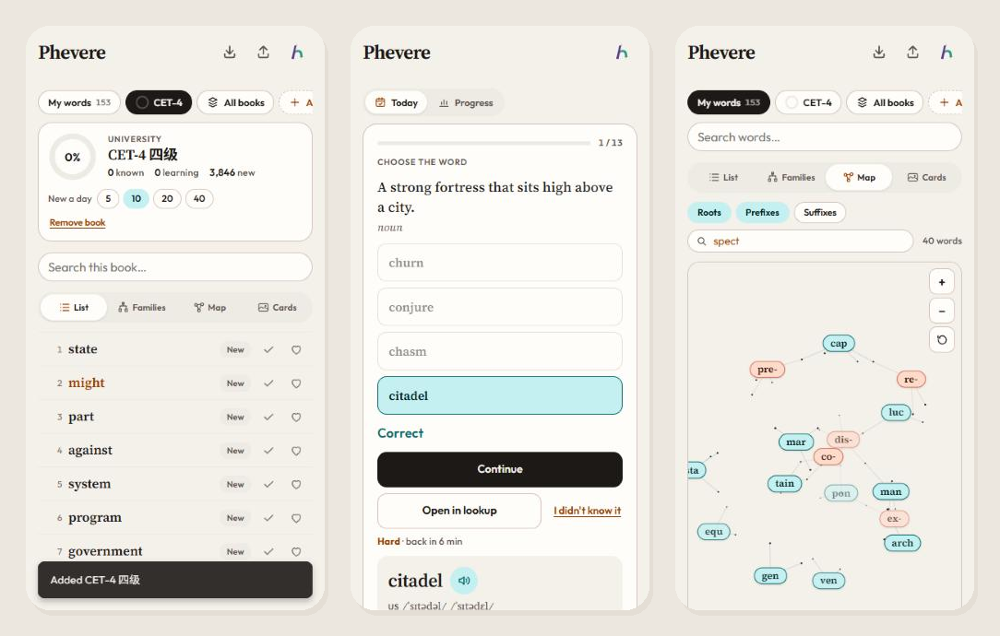
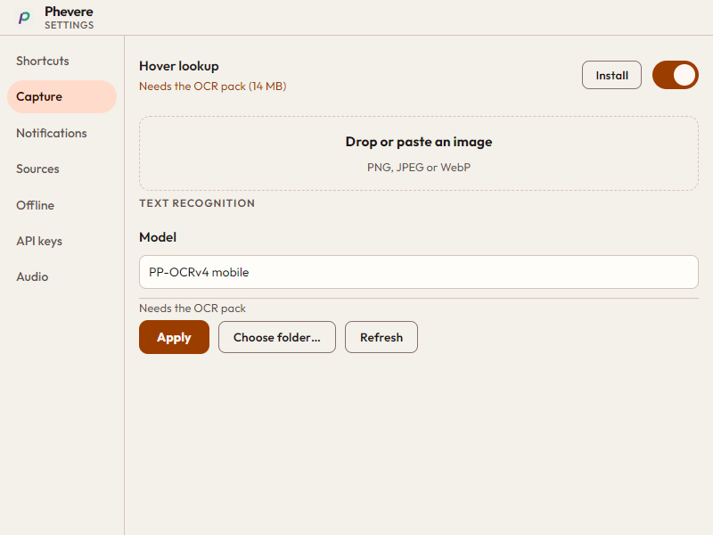

# Phevere


[](https://github.com/thd2020/phevere/releases/latest)
[](https://github.com/thd2020/phevere/actions/workflows/ci.yml)
[](LICENSE)

Phevere is a dictionary for text you are already reading. Select a word in any application and a lookup opens beside it, with definitions, pronunciation, translation, etymology, and Wikipedia, and a local notebook for the words you keep. It runs on Windows, macOS, and Linux as a tray application, and on Android and iOS as a phone app built on the same dictionary core.

<p align="center">
  
</p>
<p align="center"><sub>Android app: a lookup, a word selected on a scanned page, and the selection-bar settings.</sub></p>

The current release is **4.0.0** on desktop and phone (2026-11-03). It turns the notebook into a place to learn: Words with graded word books from primary school to CET-6 and 考研, a Learn tab with a quiz and a progress page, words that remember the page or PDF you met them in, and Families, Map and Cards redrawn. Desktop installers no longer bundle the OCR models, which the app downloads when you need them. Changes are listed in [`CHANGELOG.md`](CHANGELOG.md).

## Learning

A lookup usually ends when you close it. Phevere keeps the word, shows how it relates to the words you already know, and brings it back until you remember it. It does this in two tabs beside Lookup: Words, for what you are learning, and Learn, for practising it.

<p align="center">
  
</p>
<p align="center"><sub>A Learn question, the Progress page, the word-book library ordered by school level, and Families grouping 153 saved words by the language they came from.</sub></p>

**Words** starts with My words, everything you save from a lookup. Next to it sit word books, the graded lists Chinese learners study from: Starter 1000 for primary school, 中考, 高考, CET-4, CET-6, 考研, General English, Academic English, TOEIC and Business English, each with a progress ring and a daily goal. Their sources and licences are in [`docs/WORDBOOKS.md`](docs/WORDBOOKS.md). Progress belongs to the word, so a word you learn once counts in every book that lists it. Sources groups the words you saved by the book or site you met them in, so the words you looked up while reading *Gödel, Escher, Bach* can become a word book of their own.

Any list can be seen four ways. List shows the words in order, each with when and where you saved it and the sentence it came from. Families groups words by the parts they share, from Latin and Greek roots to the Proto-Indo-European roots Wiktionary records, by the language they came from, and as small drawn trees of one word built from another. Map shows the same relations as a 3D graph you can turn and search, and Cards lays the words out as a pile you can scatter, drag and sort.

**Learn** runs a short quiz each day over My words, one book or all of them. A new word starts with picking its meaning; as it sticks, the questions get harder: picking it from its sound, typing it from its meaning, filling it into your own sentence. Phevere grades each answer from whether it was right and how long it took, and schedules the next review with FSRS, the scheduler Anki adopted in 2023; [`docs/REVIEW.md`](docs/REVIEW.md) explains the research behind this. The Progress page shows today against your goal, your streak, how far each book has come, how well you know each word's meaning, spelling and sound, which root families you have mastered, and how much you are likely to remember over the next month.

<p align="center">
  
</p>
<p align="center"><sub>CET-4 opened as a list, the answer screen with when the word comes back, and the map of roots and prefixes the saved words share.</sub></p>

Saved words and word books sync free with a Holarky account. Syncing learning progress between devices will be part of a paid Plus membership; without it, progress stays on each device.

## Features

**Lookup**

- Definitions from Free Dictionary, Wiktionary, and Datamuse for English, and English definitions for words in other languages from Jisho (Japanese), OpenRussian (Russian) and kaikki.org (any language English Wiktionary covers). All of them are merged into a single lexicon in the headword's language. The exact form is preferred, and lemma senses are used only when no source defines that form. [`docs/MULTILINGUAL.md`](docs/MULTILINGUAL.md) lists the sources per language. English entries list the most common part of speech first and the most common senses first within it, by how often each WordNet sense is tagged in the SemCor corpus; senses no WordNet sense matches stay next to their neighbours, and other languages keep the sources' order.
- The Lexicon is set like a printed dictionary page, with part-of-speech headings, numbered senses in a serif face and examples in italic. Every word gets at least one picture beside its first sense, and up to three senses get their own: the pictures Wiktionary editors attach to senses first, then the matching Wikipedia article, which for an abstract word such as freedom or serendipity is the article about the idea, then a picture used in that article that names the word (operon shows the lac operon diagram), and then a Wikimedia Commons search of file names. Every picture comes from Wikimedia Commons and shows its author and licence on hover or tap. Pictures can be turned off with the Images switch in the pop-up settings on the desktop and in Settings → Lookup on the phone.
- A Forms section lists a word's grammatical forms: tenses and participles for verbs, plural and possessive for nouns, cases for German and Russian nouns, persons for French and Spanish verbs, and comparative and superlative for adjectives. A form such as mice says that it is the plural of mouse and shows mouse's forms. The data is Wiktionary's inflection tables as parsed by Wiktextract (kaikki.org).
- A Word family section shows a word's closest derived and related words, phrases and other spellings as short lines of links, with the rest under All, and what the word is built from.
- A misspelled English word one or two letters off (recieve, definately) is looked up and saved as the word it meant.
- IPA by accent (US and UK), each chip spoken from its own transcription by eSpeak NG. Words no online source transcribes get US IPA from the CMU Pronouncing Dictionary, or, when it lacks them too (holon, operon), from the pronunciation Datamuse gives. Recorded pronunciations come from Free Dictionary and Wikimedia Commons and are cached on disk; when a word has none, the chosen voice says it. Neural Kokoro voices (132 MB or 350 MB) can be downloaded in Settings → Audio on the desktop, Android and iOS.
- Translation through Google Translate and MyMemory without a key, or through Youdao or DeepL with your own keys. The speaker beside either side reads it aloud with the chosen voice; a long paragraph starts playing after its first sentence is ready, and pressing the speaker again stops it. Settings → API keys checks a key with one request to its provider.
- Quick translation on the desktop, off until you switch it on in Settings → Shortcuts. One shortcut replaces the selected text in any application with its translation; another opens a small panel with every engine's translation, where the arrow keys pick one and Enter pastes it. The clipboard is put back afterwards. Linux needs `xdotool`.
- Etymology from Wiktionary, Etymonline, and Youdao, and a Wikipedia reader in the same pane.
- Offline packs, listed in Settings → Offline under the language of their headwords: WordNet, Webster 1913 (GCIDE) and FreeDict English–Chinese for English; CC-CEDICT for Chinese; JMdict for Japanese; Kengdic for Korean; and FreeDict packs from German, French, Italian, Portuguese, Dutch, Polish, Russian, Greek, Finnish, Hungarian, Catalan and Croatian into English. The German pack and the full JMdict are desktop only; the phone gets JMdict's common words. Selecting a pack shows its edition, licence, source, entry count and size.
- Words are saved in dictionary form (lower case, except German nouns, proper nouns and abbreviations), and words saved earlier in another form are fixed once.
- Recent lookups, shown as the same rows as the notebook. The source language is detected by default, including Japanese text written only in kanji.
- An optional Holarky account, from the button at the right of the title bar on desktop or the app bar on the phone. Sign in with email and password, a passkey, or Google; while signed in, My words and your word books sync between your desktops and phones, including notes and deletions. Learning progress syncs with a Plus membership; without it, progress stays on each device. Without an account Phevere works as before, and lookups never wait for it.

**Words and Learn**

- Words: My words, your own list stored locally in SQLite, with search, sorting, and JSON or CSV import and export, plus word books you add from a library ordered from primary school up. A book word opens its lookup and can be added to My words, and every word shows which of your books list it. Progress belongs to the word, so learning it once counts in every book that has it. Besides the list, My words, each book and All books have Families (words grouped by shared root, prefix, suffix, origin or character, and word trees), Map (the same relations as a graph) and Cards (each word split into its parts, with your note as a mnemonic).
- Sources, in the Words tab's book switcher, groups the words you saved by the document or web site they came from (GEB.pdf, en.wikipedia.org), each with its count. Make a word book turns a source into your own book, which then appears beside the shipped books with its own progress; you can rename it, add words by name and remove words, and it syncs with the rest of your word books.
- Learn: a daily quiz over My words, one book or All books, scheduled with FSRS. It asks each due word in a harder form as you learn it, from picking its meaning to typing it into a sentence, with a daily goal and a two-week forecast; see [`docs/REVIEW.md`](docs/REVIEW.md).

**Desktop (Windows, macOS, Linux)**

- Select-to-lookup in other applications. On Windows, Phevere reads the selection through UI Automation, then a Chromium accessibility request, then a silent copy that restores the clipboard. On macOS it uses the Accessibility API, then AppleScript for Safari and Chrome, then a silent copy. On Linux it watches the primary selection that every toolkit sets on select (Wayland data-control on KDE Plasma and wlroots desktops, XFixes on X11), so nothing is copied. Password fields are skipped.
- OCR for text that cannot be selected: hover, region, clipboard image, and whole window, using PP-OCRv4 models from the OCR pack, a 14 MB download from Settings → Capture (PP-OCRv5 is available as a download).
- When you save a word from the pop-up, Phevere keeps where you met it: the app, the web page title and address in Chrome, Edge and Firefox (Safari and Chrome on macOS), the document name in a PDF reader (Acrobat, Foxit, SumatraPDF, WPS, or a PDF tab in a browser) with the page number when the reader shows it, and on Windows the sentence around the word. Private and incognito windows are never recorded. Settings → Capture → Remember where words were saved turns it off.
- Back and forward through recent lookups, including the mouse's extra buttons.
- A slim toolbar opens beside the selection. Its first four icons open the Lexicon, Translation, Wikipedia, and Etymology views, and the open view shows as a tab joined to the page.

**Android**

- **Phevere** on the system text-selection bar opens a compact lookup beside the selected word. The lookup is a floating window over the current app when *Display over other apps* is granted, and a bottom sheet otherwise.
- *Pop up on selection* opens the lookup as soon as text is selected, without a tap. Without root this uses an accessibility service; on rooted devices it uses the LSPosed module described below.
- A word saved from the selection-bar lookup keeps the name of the app it came from, and with the LSPosed module also the screen's title and, in an app showing a web page, its address.
- Scan: take or choose a photo and select words directly on the picture. Recognition runs on the device with ML Kit, for Latin and Chinese script.
- Pronunciation works offline with a bundled eSpeak NG voice. Two optional neural voices (Kokoro, 132 MB and 350 MB) can be downloaded in Settings.

**iOS**

- Share text to Phevere, or open `phevere://lookup?q=word`, to show the lookup as a floating card or a sheet.
- Selected text inside the app has a **Phevere** item in the edit menu. Scan uses Apple Vision. Pronunciation uses the voices installed on the device, or one of the two Neural Kokoro voices (132 MB or 350 MB) downloaded in Settings → Audio.

## Installation

### Windows, macOS, and Linux

Download the installer for your platform from [GitHub Releases](https://github.com/thd2020/phevere/releases/latest). Node.js is not required.

| Platform | File |
|---|---|
| Windows 10 and 11, x64 | `Phevere-Setup-<version>-x64.exe` |
| Windows 11, ARM64 | `Phevere-Setup-<version>-arm64.exe` |
| macOS 11 or later, Intel | `Phevere-<version>-darwin-x64.dmg` |
| macOS 11 or later, Apple silicon | `Phevere-<version>-darwin-arm64.dmg` |
| Debian, Ubuntu 22.04 or later, x64 / arm64 | `phevere_<version>_amd64.deb` / `phevere_<version>_arm64.deb` |
| Fedora, openSUSE, x64 / arm64 | `phevere-<version>-1.x86_64.rpm` / `phevere-<version>-1.arm64.rpm` |
| Any glibc 2.35+ distribution, x64 / arm64 | `Phevere-<version>-x64.AppImage` / `Phevere-<version>-arm64.AppImage` |

Since 2026-11-03 the installers do not include the OCR models. Hover lookup over text that cannot be selected, and Scan, need the OCR pack: open **Settings → Capture** and select **Install** next to Hover lookup (14 MB). Until then that row says "Needs the OCR pack" and the Hover chip at the bottom of the notebook reads No OCR. On Windows you can also tick the OCR pack under Custom options, and upgrading an installation of 3.0 or earlier keeps the models it already has. On macOS and Linux an upgrade replaces the whole app, so install the pack again.

<p align="center"></p>

Release builds are not code-signed, so Windows SmartScreen and macOS Gatekeeper will ask for confirmation on first launch. [`docs/CODE_SIGNING.md`](docs/CODE_SIGNING.md) describes how to sign your own builds.

**Windows.** Select Install, or open Custom options to choose the folder, Start menu and desktop shortcuts, starting with Windows, and two downloads: the OCR pack (14 MB) and, on x64, a pronunciation voice, Standard (132 MB) or High quality (350 MB). High quality is the recommended one: on most PCs it is also the faster of the two. Downloads run before setup finishes, and the page shows the space required. The default folder is `C:\Program Files\Phevere`; replacement installs reuse the existing folder and preserve your notebook and settings. Running Phevere as administrator lets UI Automation read selections in elevated applications. To uninstall, use **Settings → Apps → Phevere**. Normal uninstall retains your notebook and settings. If an earlier installation left files behind that the Apps list no longer shows, run `scripts\remove-ghost-phevere.ps1` from an elevated PowerShell prompt.

**macOS.** Drag Phevere to Applications and open it with right-click → **Open** the first time. Grant **Accessibility** for select-to-lookup and **Screen Recording** for OCR; the menu-bar icon links to both settings. See [`docs/MACOS_SELECTION.md`](docs/MACOS_SELECTION.md).

**Linux.** Install the deb with `sudo apt install ./phevere_<version>_amd64.deb` or the rpm with `sudo dnf install ./phevere-<version>-1.x86_64.rpm`; or make the AppImage executable and run it. Select-to-lookup works without setup on KDE Plasma, wlroots desktops (Sway, Hyprland) and any X11 session. On KDE Plasma Wayland the popup opens at the pointer and hover lookup follows it there too. GNOME on Wayland gives applications no background access to the selection; bind the command `phevere --lookup-selection` to a keyboard shortcut in **Settings → Keyboard → Custom Shortcuts** and press it after selecting. The tray icon needs a panel that hosts StatusNotifierItem icons, which KDE Plasma, Cinnamon, Budgie, XFCE and waybar's tray module do. GNOME needs the AppIndicator extension. If the panel starts after Phevere, the icon appears once the panel is up; if no tray turns up within a minute, Phevere shows a notification, and running `phevere` again reopens its window. Notebook and settings live in `~/.config/phevere`. See [`docs/LINUX_SELECTION.md`](docs/LINUX_SELECTION.md).

### Android

Android 7.0 (API 24) or later. Download `Phevere-<version>-android.apk` from [GitHub Releases](https://github.com/thd2020/phevere/releases/latest); the app is not in an app store. The APK is debug-signed, and each build is signed with its runner's debug key, so installing a newer release may require uninstalling the old one first. The version shown by the installer has the form `<version>-dev.<build>+<commit>`. Each CI run on `main` also builds an APK, available from the run's **Artifacts** section as `phevere-android`.

The LSPosed module is optional and requires a rooted device. Enabled in LSPosed for the apps you choose, it hooks the system text-selection toolbar so that Phevere appears at a position you set, is added back in apps that hide third-party actions (X, for example), and can be pressed automatically on selection. Setup steps are in [`apps/mobile/ANDROID.md`](apps/mobile/ANDROID.md).

### iOS

iOS 15.1 or later. Download `Phevere-<version>-ios-unsigned.ipa` from [GitHub Releases](https://github.com/thd2020/phevere/releases/latest) and sign it with your own signing tool before installing it on a device.

## Privacy

- The notebook and settings are stored on the device. Without an account, Phevere keeps nothing off the device.
- The Holarky account is optional. Sign-in runs on Auth0; while you are signed in, your profile and notebook are stored by the Holarky service on Cloudflare so that your devices match. Delete account in the account panel removes the account everywhere; the notebook on the device stays. See the [privacy page](https://holarky-api.thdfreelancer.workers.dev/privacy).
- Lookups and translations are sent only to the services enabled in Settings.
- Selection capture skips password fields, and a silent copy restores the previous clipboard contents.
- Where a word was saved (page title, address, document name and sentence) is stored only in your notebook and, when you are signed in, synced only inside your own account. Private and incognito browser windows are skipped, and only web addresses are kept, never local file paths.
- On macOS, Screen Recording permission is used only for OCR.
- On Android, the LSPosed module adds only the Phevere item to a selection bar. When an app gives no other way to read the selection, the module copies the selected text and then restores the clipboard.

## Building from source

### Prerequisites

- Node.js 18 or later (CI uses Node.js 22)
- Windows: Visual Studio 2022 with the *Desktop development with C++* workload, for the UI Automation addon
- macOS: Xcode Command Line Tools
- Linux: `build-essential pkg-config libx11-dev libxfixes-dev libatspi2.0-dev libglib2.0-dev libwayland-dev`, plus `fakeroot rpm squashfs-tools` to build packages
- Android: JDK 17 or later and the Android SDK (API 36, NDK 28.2, CMake 3.22.1); Python 3 for the speech bundle
- iOS: Xcode on macOS

### Desktop

```bash
git clone https://github.com/thd2020/phevere.git
cd phevere
npm install
npm start
```

To build installers:

```bash
npm run build-native
npm run make:win          # Windows x64 installer
npm run make:win:arm64    # Windows ARM64 installer
npm run make:mac:x64      # macOS Intel DMG
npm run make:mac:arm64    # macOS Apple silicon DMG
npm run make:linux:x64    # Linux x64 deb, rpm, AppImage (cross-builds from an arm64 machine)
npm run make:linux:arm64  # Linux arm64 deb, rpm, AppImage
```

Output is written to `out/make`. [`PACKAGING.md`](PACKAGING.md) covers the installer configuration. If the Electron download stalls during `npm install`, set `ELECTRON_SKIP_BINARY_DOWNLOAD=1`; the install and start scripts then fetch the runtime with `scripts/ensure-electron.js`.

### Mobile

```bash
npm run mobile:dev        # phone UI in a desktop browser, with development proxies
npm run mobile:build      # build the web bundle and copy it into the Android and iOS projects
```

For the Android APK, prepare the speech bundle and run Gradle:

```bash
python apps/mobile/scripts/prepare-speech.py
cd apps/mobile/android
./gradlew assembleDebug
```

For iOS, open `apps/mobile/ios/App/App.xcodeproj` in Xcode. Further detail is in [`docs/MOBILE.md`](docs/MOBILE.md) and [`apps/mobile/ANDROID.md`](apps/mobile/ANDROID.md).

### Continuous integration and releases

Every pull request and every push to `main` builds the desktop applications for Windows, macOS, and Linux, the Android APK, and the iOS IPA, and runs the mobile regression tests. A tag of the form `v*.*.*` builds the Windows installers, macOS disk images, Linux packages, Android APK, and iOS IPA, attaches them to a GitHub Release, and publishes build provenance attestations. Pushing a new `version` in `package.json` to `main` creates that tag and starts the release; a tag pushed by hand works too. See [`docs/RELEASE.md`](docs/RELEASE.md).

## Project structure

| Path | Contents |
|---|---|
| [`packages/core`](packages/core) | Dictionary sources, merging, translation, pronunciation, notebook storage, and the Holarky account and notebook sync, shared by all platforms |
| [`src`](src) | Desktop application (Electron main process and renderer) |
| [`native-addon`](native-addon) | Selection capture: UI Automation on Windows, Accessibility on macOS, primary selection and AT-SPI on Linux |
| [`apps/mobile`](apps/mobile) | Phone user interface, and the native Android and iOS projects that host it |
| [`packaging`](packaging) | Installer configuration and icons |
| [`docs`](docs) | Platform notes, release process, and design documents |

## Documentation

- [`docs/ACCOUNT.md`](docs/ACCOUNT.md): the Holarky account and notebook sync
- [`docs/WORDBOOKS.md`](docs/WORDBOOKS.md): the word books, where each list comes from and its licence
- [`docs/REVIEW.md`](docs/REVIEW.md): how Learn quizzes and schedules words, and the research behind it
- [`docs/MOBILE.md`](docs/MOBILE.md): phone apps, architecture, and limitations
- [`apps/mobile/ANDROID.md`](apps/mobile/ANDROID.md): Android build, speech, versioning, and the LSPosed module
- [`docs/MACOS_SELECTION.md`](docs/MACOS_SELECTION.md): macOS permissions and selection capture
- [`docs/LINUX_SELECTION.md`](docs/LINUX_SELECTION.md): Linux selection capture, desktops, and limits
- [`docs/MULTILINGUAL.md`](docs/MULTILINGUAL.md): supported languages and sources
- [`docs/OCR_CONTEXT_CAPTURE.md`](docs/OCR_CONTEXT_CAPTURE.md): the OCR pipeline

## License

Phevere is released under the [MIT License](LICENSE). The names Phevere, Holarky and knowrld and their logos are not covered by it; see [`TRADEMARKS.md`](TRADEMARKS.md). The Android application and the desktop builds bundle eSpeak NG, which is licensed under GPL-3.0-or-later; see [`apps/mobile/ANDROID.md`](apps/mobile/ANDROID.md) for the licence terms of the distributed APK. The sense-frequency table in `packages/core/src/sense-frequency-data.ts` is derived from Princeton WordNet 3.1 under the WordNet licence, whose notice is kept at the top of that file.
