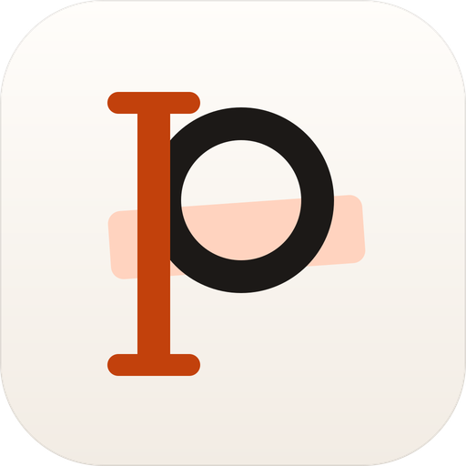
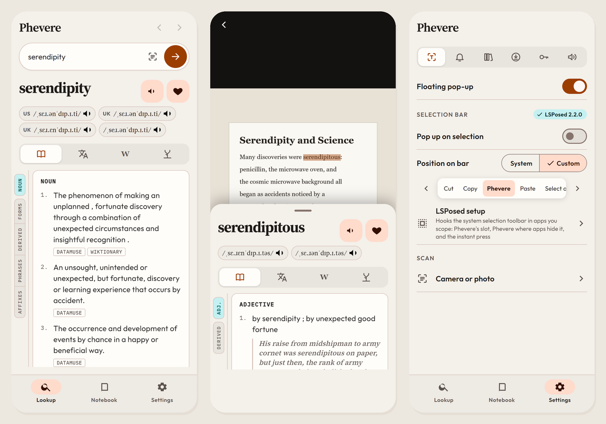
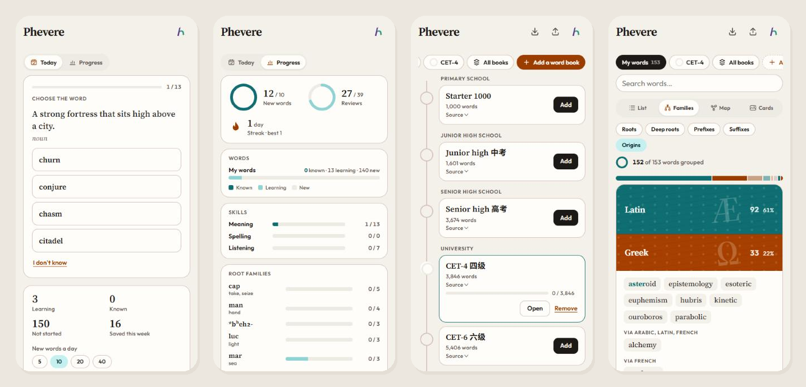

<div align="center">

[English](README.md) · [简体中文](README.zh-CN.md) · [繁體中文](README.zh-TW.md) · [日本語](README.ja.md) · [한국어](README.ko.md) · [Español](README.es.md) · [Français](README.fr.md) · [Deutsch](README.de.md) · **Русский** · [Português (Brasil)](README.pt-BR.md)



<h1>Phevere</h1>

<p>Выделите слово в любом приложении и найдите его значение прямо там, где читаете. Сохраните его и выучите.</p>

[](https://github.com/thd2020/phevere/releases/latest)
[](https://github.com/thd2020/phevere/actions/workflows/ci.yml)
[](LICENSE)

[Скачать](https://github.com/thd2020/phevere/releases/latest) · [Что нового](CHANGELOG.md) · [Документация](docs)



</div>

## О программе

Phevere — словарь, который работает везде, где вы читаете. Выделите слово в любом приложении, чтобы увидеть его значение, произношение, перевод и происхождение, а потом сохраните его, чтобы выучить позже. Phevere работает в Windows, macOS, Linux, Android и iOS.

## Возможности

**Поиск**

- Определения, картинки, произношение, перевод, этимология и Википедия в одном месте
- Американское и британское произношение, дополнительные голоса можно скачать
- Перевод через Google Переводчик, MyMemory, Youdao или DeepL
- Формы слова и отдельные страницы для приставок, суффиксов и корней
- Подсказки при вводе
- Офлайн-словари для шестнадцати языков
- Определения слов на многих языках помимо английского ([языки](docs/MULTILINGUAL.md))

**Обучение**

- Словари для заучивания от начальной школы до CET-6, 考研, TOEIC и делового английского ([список](docs/WORDBOOKS.md))
- Сохранённые слова помнят, где вы их встретили
- Семьи слов, карта слов и карточки
- Ежедневное повторение по методу интервальных повторений ([как это работает](docs/REVIEW.md))
- Графики прогресса
- Импорт и экспорт в Anki ([формат файла](docs/BOOK_FORMAT.md))
- Синхронизация между устройствами с бесплатной учётной записью ([учётная запись](docs/ACCOUNT.md))

**На ваших устройствах**

- Компьютер: поиск выделенного текста в любом приложении или слов на изображениях, а также перевод выделенного текста прямо на месте
- Android: поиск из меню выделения текста в любом приложении и сканирование слов с фотографий
- iOS: поиск из меню «Поделиться» и сканирование слов с фотографий

<div align="center">

<p><sub>Повторение, прогресс, словари для заучивания и семьи слов.</sub></p>
</div>

## Скачать

Скачайте Phevere со страницы [последнего выпуска](https://github.com/thd2020/phevere/releases/latest). Нужна Windows 10, macOS 11, Ubuntu 22.04 или Fedora 36, Android 7.0 или iOS 15.1 и новее. Приложение для iOS перед установкой нужно подписать своей учётной записью Apple.

При первом запуске Phevere Windows и macOS показывают предупреждение; выберите запуск всё равно. Инструкции по установке: [macOS](docs/MACOS_SELECTION.md), [Linux](docs/LINUX_SELECTION.md), [Android](apps/mobile/ANDROID.md).

## Обновления

Phevere обновляется сам. В разделе **Settings → Updates** выберите Automatically (автоматически), Ask first (сначала спросить) или Off (выключено).

- В Windows и AppImage обновление устанавливается, когда вы закрываете Phevere, а кнопка **Roll back** возвращает предыдущую версию.
- В macOS, deb и rpm открывается страница загрузки новой версии.
- В Android обновление скачивается по Wi-Fi, а перед установкой приложение просит подтверждения.

В разделе **Settings → About** видно, какая у вас версия, что нового и куда сообщить о проблеме.

## Конфиденциальность

Ваши слова и настройки остаются на устройстве, пока вы не войдёте в учётную запись для синхронизации. Phevere никогда не читает поля паролей и не записывает приватные окна браузера. Подробнее — в [политике конфиденциальности](https://holarky-api.thdfreelancer.workers.dev/privacy).

## Сборка из исходного кода

```bash
git clone https://github.com/thd2020/phevere.git
cd phevere
npm install
npm start
```

Нужны Node.js 18 или новее и набор инструментов C++ для нативного модуля: Visual Studio 2022 в Windows, Xcode Command Line Tools в macOS, а в Linux — `build-essential pkg-config libx11-dev libxfixes-dev libatspi2.0-dev libglib2.0-dev libwayland-dev`. Скрипты `npm run make:*` собирают установщики ([упаковка](PACKAGING.md)), а `npm run mobile:dev` запускает мобильное приложение в браузере ([мобильная версия](docs/MOBILE.md)). Когда в `main` попадает новый номер версии, публикуется новый выпуск ([выпуск](docs/RELEASE.md)).

| Путь | Содержимое |
|---|---|
| [`packages/core`](packages/core) | Источники словарей, словарная тетрадь и синхронизация, общие для всех платформ |
| [`src`](src) | Приложение для компьютера (Electron) |
| [`native-addon`](native-addon) | Захват выделенного текста в Windows, macOS и Linux |
| [`apps/mobile`](apps/mobile) | Мобильное приложение и его проекты для Android и iOS |
| [`docs`](docs) | Заметки о платформах и проектные документы |

## Лицензия

[MIT](LICENSE). Названия Phevere, Holarky и knowrld и их логотипы под неё не подпадают; см. [TRADEMARKS.md](TRADEMARKS.md). Тексты словарных статей из Викисловаря и Википедии распространяются по лицензии CC BY-SA 4.0. Приложения включают eSpeak NG по лицензии GPL-3.0-or-later ([условия](apps/mobile/ANDROID.md)), а таблица частотности значений получена из Princeton WordNet 3.1 по лицензии WordNet. Все источники данных и их лицензии перечислены в разделе **Settings → About**.

Если Phevere вам помогает, поставьте ему [звезду на GitHub](https://github.com/thd2020/phevere): так его проще найти другим.
