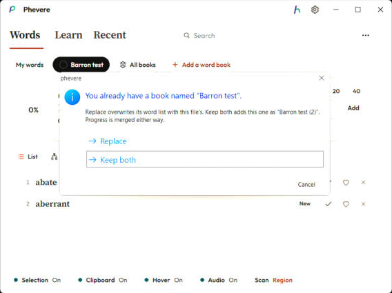

# Word book files (.pvbook)

Phevere saves one word book per file. Export writes the book you are looking at in Words (My words, a book you made, or one of Phevere's books), and Import reads it back on any device, the desktop or the phone. The file carries every word with everything Phevere keeps about it and the answer history behind its progress, so a book moved to a new device picks up where it was.

The same menus also read and write Anki decks, so a deck can come over from Anki and a book can go back to it. The code is in `packages/core/src/book-file.ts` (the container), `book-transfer.ts` (export and import against the notebook) and `anki-import.ts` (Anki). The test is `scripts/test-book-file.js`.

## What a file holds

The payload is JSON with this shape. `book.kind` says where the book lives: `mine` is My words, `user` a book the reader made, and `catalog` one of the books in Phevere's library, which the file names by id instead of carrying its word list.

```json
{
  "format": "phevere-book",
  "version": 1,
  "exportedAt": 1793723400000,
  "app": "Phevere 4.0.0",
  "book": { "kind": "user", "id": "ub_…", "title": "Reading list", "source": "doc:geb.pdf", "goal": 10 },
  "words": [
    { "lemma": "braid", "definition": "a length of hair woven together", "sourceLang": "en",
      "context": { "app": "Acrobat", "doc": "GEB.pdf", "page": 12, "sentence": "An Eternal Golden Braid." },
      "createdAt": 1786348736045, "device": "laptop" }
  ],
  "answers": [ { "id": "…", "lemma": "braid", "answeredAt": 1793636000000, "…": "…" } ]
}
```

Each word keeps its reading, meaning, part of speech, languages, sources, note, tags, the sentence it was saved from, the device and the date it was saved. A word from before 4.0 has no answer history, so its schedule travels as it stood, in `schedule`.

## The container

The JSON is wrapped in a small binary header so the app can tell a book file from anything else and so a book can later be locked to an account.

| Offset | Size | Field |
| --- | --- | --- |
| 0 | 4 | `PVBK` |
| 4 | 1 | Version, 1 |
| 5 | 1 | Flags: 1 compressed, 2 encrypted, 4 signed |
| 6 | 2 | Reserved, 0 |
| 8 | 4 | Payload length, little-endian |
| 12 | n | Payload |
| 12 + n | 72 | When signed: an 8-byte key id and a 64-byte Ed25519 signature of everything before it |

A book you export yourself is compressed with deflate and nothing else, which keeps My words with 600 words under 80 KB. That stops the file from being read or edited as text, but it is not secret: anyone who knows deflate can open it.

Books Phevere sells will be encrypted with AES-256-GCM (a 12-byte IV, then the ciphertext of the compressed JSON) and signed with Ed25519. The key comes from the account, so only a signed-in reader who owns the book can open it, and the signature means a changed file is refused. The reading side is built and tested: a signed file opens when the app trusts the key, a file changed by one byte is refused, and an encrypted file with no key says it needs Plus. The issuing side lives on the Holarky account server and does not exist yet.

## Importing

Import accepts a `.pvbook`, an Anki package (`.apkg`), Anki's text export (`.txt`), or an older Phevere `.json` or `.csv` export of My words.

My words always merges. A word you already have is left as it is unless the file fills a field that is empty here, so importing the same file twice adds nothing and does not touch the saved words.

A book you made, imported where a book of the same name already exists, asks first. Replace overwrites that book's word list with the file's, and Keep both adds the file as "Reading list (2)". Progress is merged either way.



*The same question on the phone uses the app's own sheet, with Keep both first.*

One of Phevere's books that you already added asks whether to merge the file's progress into it.

Progress comes in as answers. They are merged by id, and each word's schedule is then rebuilt from its whole history, the same way sync does it, so a word answered on two devices ends up with one schedule that counts both.

## Anki

An `.apkg` is a zip with the collection inside as SQLite. Phevere reads `collection.anki21b` (zstd compressed, Anki 2.1.50 and later), `collection.anki21` or `collection.anki2`, newest first, because a package from a new Anki also carries an `anki2` stub whose only note says to update. The first field of each note is the word and the second its meaning, as in Anki's Basic note type, with HTML and sound tags stripped. The deck holding most cards names the book. Each deck becomes a book you made, and its meanings become the meanings Learn asks about.

Anki's scheduling history (the `revlog` table) is not imported, so words from Anki start as new. Pictures and sounds in the package's media are not imported either.

Export for Anki writes Anki's text format with headers that name the separator, the note type and the deck, so File → Import in Anki 2.1.55 or later sets up the deck without questions:

```text
#separator:tab
#html:true
#notetype:Basic
#deck:Reading list
#columns:Front	Back
braid	a length of hair woven together
```

The reading, when there is one, goes on the back above the meaning.
