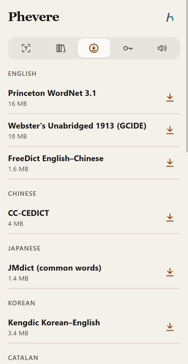

# Multilingual dictionary and pronunciation

Updated 2026-11-03: Settings → Sources has a group, Definitions in other languages, with Chinese, Russian and Japanese Wiktionary, all off until switched on. Japanese is no longer read aloud by the Chinese voice; without an installed Japanese voice, Google Translate's voice reads it.

Updated 2026-11-02: a Japanese, Russian, Korean, German or other non-English word now gets English definitions from a dictionary made for its language, both online and from offline packs, and Settings → Offline lists packs under their language.

## Dictionary: any language to English

Phevere detects the language of the selection, or uses the one you pick as the source language, and asks every source that covers it in parallel. The senses are merged into one list, with the sources that agree on a sense cited together.

| Source | Languages | Licence of the data | Notes |
|---|---|---|---|
| Free Dictionary (`dictionaryapi.dev`) | English | CC BY-SA (Wiktionary) | Primary for English. |
| English Wiktionary REST | Every language it has an entry for | CC BY-SA 4.0 | Reads the section for the detected language, so собака is answered from the Russian section. |
| Datamuse | English | WordNet glosses | |
| Jisho (`jisho.org/api/v1`) | Japanese | JMdict, CC BY-SA 4.0 | Exact spellings and readings, plus the dictionary form of a conjugated query (たべました gives 食べる). Words that only contain the query are dropped. |
| OpenRussian (`api.openrussian.org`) | Russian | CC BY-SA 4.0 | Matches the lemma or an inflected form (собаки gives собака), with usage domains and example sentences. |
| kaikki.org | Every language kaikki extracts from English Wiktionary | CC BY-SA 4.0 and GFDL | One small JSON file per word and language, with IPA and inflection glosses such as "plural of Haus". |
| Offline packs | See below | Per pack | Packs for the word's language answer first. |

Jisho and OpenRussian count toward the first paint the way Free Dictionary and Wiktionary do. Kaikki mostly repeats Wiktionary, so it arrives in the update that follows. Every source keeps the existing timeouts, its own cache layer and the skip-when-failing rule, and each has a switch in Settings → Sources.

A single Latin-script word is detected as English unless you choose another language, because a spelling such as "Haus" or "casa" does not say which language it is. When the English sources find nothing, or only say the word is a surname (Wiktionary's only English entry for Haus), Phevere falls back to kaikki's page for that spelling in all languages and to the installed packs of other languages, and that answer becomes the first paint. Haus then shows the German noun and Häuser shows "plural of Haus". An English word that the English sources know never triggers the fallback, so "gift" is not answered with the German word for poison.

An all-Han word is treated as Chinese unless it contains a kanji that only Japanese uses, such as 対 or 応 in 要対応. Kana still means Japanese and Hangul means Korean.

Two choices were left out on purpose. Naver and Daum have no public API and forbid scraping, and the Korean National Institute's dictionary API needs a key, so Korean relies on Wiktionary, kaikki and the Kengdic pack. Commercial dictionaries (Oxford, Collins, WordsAPI) stay optional and keyed.

## Definitions in other languages

Three opt-in sources define words in a language other than English. They are kaikki.org's extracts of other Wiktionary editions, in the same one-file-per-word JSONL format as the English edition, so they share its parser.

| Source | Used for | Definitions in |
|---|---|---|
| Chinese Wiktionary (`kaikki.org/zhwiktionary`) | Words of every language | Chinese |
| Russian Wiktionary (`kaikki.org/ruwiktionary`) | Russian words | Russian |
| Japanese Wiktionary (`kaikki.org/jawiktionary`) | Japanese words | Japanese |

The Chinese edition stores most entries under traditional characters; a simplified form such as 学生 is only a pointer to 學生, and the fetcher follows that pointer once. Senses tagged literary (书面语 and Classical usage) are shown with 〈书〉 in front, the label 现代汉语词典 uses. Its examples come in a traditional and a simplified copy with the same translation; only the simplified one is shown.

现代汉语词典 and 古代汉语词典 themselves are not offered. They are published by the Commercial Press with no licence for redistribution or an API, so the Chinese Wiktionary is the open substitute: it covers modern Chinese and marks literary and Classical senses.

The senses sort after the dedicated dictionaries and before English Wiktionary. For a word in another language they count toward the first paint; for an English word they join in the update that follows. Saved words record the gloss language by script (kana is Japanese, mostly Cyrillic is Russian, mostly Han is Chinese), so a Japanese gloss is not filed as Chinese.

## Reading aloud in the right language

The bundled voices read English and Chinese (neural or eSpeak) and many other languages (eSpeak). eSpeak's Japanese reads only kana, so Japanese text goes to the pop-up instead: an installed Japanese system voice reads it when there is one, otherwise Google Translate's voice does, in pieces of up to 180 characters. A voice for a different language is never used as a stand-in, so a PC whose default voice is Chinese no longer reads Japanese in Chinese. Kana or hangul in the text wins over a Chinese language hint.

## Offline packs

Settings → Offline groups the catalog under the language of the headwords: English, Chinese, Japanese and Korean first, then the rest from A to Z. Each pack shows its name, its download size or, once installed, its entry count, and a Download or Remove button. The download prompt names the source and the licence.

The phone's Offline settings: each language heading lists its packs with a size and a download button.

| Pack | Headwords | Licence | Desktop | Phone |
|---|---|---|---|---|
| Princeton WordNet 3.1 | English | WordNet License | yes | yes |
| Webster's Unabridged 1913 (GCIDE) | English | GPL 3 or later | yes | yes |
| FreeDict English–Chinese | English | GPL | yes | yes |
| CC-CEDICT | Chinese | CC BY-SA 4.0 | yes | yes |
| JMdict, from jmdict-simplified 3.6.2 | Japanese | EDRDG, CC BY-SA 4.0 | full, 219k entries | common words, 22.6k entries |
| Kengdic | Korean | MPL 2.0 or LGPL 2.0 or later | yes | yes |
| FreeDict German–English (Ding) | German | GPL 3 and AGPL 3 | yes | no |
| FreeDict French, Portuguese, Dutch, Croatian–English | those languages | GPL 2 or later | yes | yes |
| FreeDict Hungarian–English | Hungarian | GPL 2 | yes | yes |
| FreeDict Italian, Polish, Russian, Greek, Finnish, Catalan–English (WikDict) | those languages | CC BY-SA 3.0 | yes | yes |

The German pack is 18 MB to download but unpacks to a 450 MB TEI file with 518k rows, which the phone cannot hold, so only the desktop offers it. The desktop reads every large file line by line and writes it in batches. FreeDict publishes only `.tar.xz`, which the phone now unpacks with its own decoder (`packages/core/src/xz-decode.ts`).

FreeDict also has Spanish–English (4,500 headwords), Swedish–English (5,200) and Arabic–English, but the first two are marked too small by FreeDict itself and the Arabic glosses are unreliable (بيت comes back as "Bett; Pete"), so they are not offered. Current Oxford, Collegiate Webster and Collins editions are not redistributable as dumps.

The catalog lives in `packages/core/src/offline-catalog.ts` and the parsers in `packages/core/src/offline-pack-parsers.ts`; `scripts/test-multilingual-sources.js` checks both against trimmed real downloads.

## Pronunciation (speaker)

**Popup toolbar 🔊** plays a recorded clip: Free Dictionary MP3 when that API answered, otherwise the Wiktionary Commons file from `{{audio}}`. Fetched in the main process (ogg/mp3). It does not use `speechSynthesis` on the spelling.

**Translation speakers** (2026-11-03) read the source or the translated text with the voice chosen in Settings → Audio. `src/services/speech.ts` splits the text into sentence chunks with `splitSpeechText` (`packages/core/src/speech-chunks.ts`): the first chunk is one short sentence, so the mechanical voice starts within a fraction of a second, and the popup asks for the next chunk only when the current one finishes, so the worker synthesizes at most one chunk ahead. Jobs reach the worker one at a time from a queue in the main process; pressing the speaker again, starting other speech, hiding or closing the popup drops whatever is still queued. Before this change the whole text, cut at 500 characters, went to the worker as one job, and nothing played until all of it was synthesized. With a neural voice on a slow CPU that could take longer than the 60-second timeout, after which the eSpeak fallback queued behind the job that was still running. `scripts/test-speech-stream.js` covers the splitting, the one-ahead rule and cancellation.

The neural voice is slower. Measured on 2026-11-03 with the 132 MB int8 Kokoro model on an i5-10500 with six cores, it needs about 1.4 seconds of synthesis per second of speech, so a 125-word paragraph starts after about 4 seconds and pauses between chunks. The worker runs Kokoro on two threads, because three, four or six threads were no faster and used up to 160 percent more CPU time. Looking up a phrase also loads the neural voice in the worker ahead of time (`warmSpeech` in `src/services/speech.ts`), which takes about 4 seconds off the first press.

**IPA chip speakers** send that chip’s IPA to a long-lived System.Speech host in the main process (Windows) or `say` `[[inpt PHON]]` (macOS). Chromium `speechSynthesis` strips SSML, so the renderer cannot speak IPA itself.

**Root causes addressed**

1. Buttons called `playAudio(word, 'en')` so **Japanese/Korean text was requested as English**.
2. When no OS voice matched, the code **forced English voice + English lang** — useless for CJK and often **silent**.
3. **Script order:** Kana/Korean/Han detection reordered so Kana is not classified as Chinese first.

**Still required on Windows:** Install **speech language packs** (Settings → Time & language → Language → add Japanese/Korean → Speech). Without voices, Chromium may still attempt `utterance.lang = 'ja-JP'` with `voice = null`; quality varies.

**Optional next step:** Fallback TTS via **Google Translate TTS** or **Azure TTS** (network, API keys) when `speechSynthesis` has no voice.
