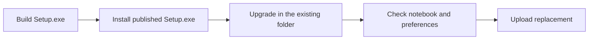

# Publishing a GitHub release

2026-10-14: A Windows ARM64 release can be retried alone with `targets=windows-arm64`.

2026-10-14: Windows builds wrap the NSIS upgrade backend with the illustrated native setup frontend. Selected audio models download before setup finishes. Local builds require the Windows .NET Framework compiler and WPF assemblies, which are also present on the GitHub Windows runners.

2026-10-14: Windows uploads require the installer upgrade check to pass. The check upgrades the previously published build at its actual recorded path and verifies the notebook and settings. If the older installer uses a different folder, the check then uninstalls that fixture and installs the current build in a custom folder with spaces without deleting user data. Same-version replacement, component choices, and running-app shutdown are checked there.



Keep `package.json` `version`, the git tag, and `CHANGELOG.md` in sync.

## Unattended (GitHub Actions)

After `.github/workflows/release.yml` is on `main`:

1. Bump `"version"` in `package.json`, add a `## [x.y.z]` section to `CHANGELOG.md`, commit, push `main`.
2. Tag and push (this **builds** Windows Setup + macOS DMGs, **creates** the GitHub Release, and **attests** each file):

```powershell
git tag -a v1.2.3 -m "Release v1.2.3"
git push origin v1.2.3
```

Watch **Actions → release**. That workflow makes **four** desktop artifacts onto one tag: Windows **x64** (`windows-latest`) and **ARM64** (`windows-11-arm`) Setup.exe, plus macOS **Intel** (`macos-15-intel`) and **Apple Silicon** (`macos-latest`) DMGs. Each file is uploaded and attested. No Environment approval gate. Windows Setup is unsigned unless repo secrets `CSC_LINK` + `CSC_KEY_PASSWORD` are set (OV/EV PFX). Mac DMGs are unsigned (Gatekeeper). Blank Windows secrets are stripped in `scripts/make-win.js` so electron-builder does not treat `""` as a cert path. Verify:

```powershell
gh attestation verify out/make/nsis/x64/Phevere-Setup-1.2.3-x64.exe -R thd2020/phevere
```

CI (no installer): `.github/workflows/ci.yml` on every PR and push to `main` (Windows and macOS unpackaged apps, each with `verify-ocr-pack`; Android APK and iOS IPA). Phone binaries stay on the run’s **Artifacts** tab — they are not attached to a GitHub Release.

## Local fallback (optional)

Windows + Node.js + VS C++ (native addon):

```powershell
npm ci
npm run make:win
```

Artifact: `out\make\nsis\x64\Phevere-Setup-<version>-x64.exe`  
ARM64 (native ARM Windows, or `npm run make:win:arm64`): `out\make\nsis\arm64\Phevere-Setup-<version>-arm64.exe`

If `github.com` times out while packaging, `make:win` already uses npmmirror. Ghost Program Files installs: `scripts/remove-ghost-phevere.ps1` (see README / PACKAGING.md).

```powershell
Get-FileHash -Algorithm SHA256 "out\make\nsis\x64\Phevere-Setup-*-x64.exe"
```

The workflow owns the Windows Setup and macOS DMG assets. The same tag also gets the Android APK and unsigned iOS IPA; the phone version comes from `apps/mobile/package.json`. To replace files on an existing tag from current `main`, run Actions → release with `attach_tag` and `targets` set to all, desktop, or phone. Use `windows-arm64` to retry only that installer. The workflow replaces same-named files after their checks pass and keeps the git tag in place. Windows and macOS jobs share `scripts/gh-delete-release-asset.ps1`. If the tag exists without a GitHub Release, dispatch creates the Release.

## Notes template (if you write notes by hand)

```markdown
## Downloads

- **Windows x64 Setup:** `Phevere-Setup-x.y.z-x64.exe` (NSIS, directory chooser)
- **Windows ARM64 Setup:** `Phevere-Setup-x.y.z-arm64.exe` (Snapdragon / Windows 11 ARM)
- **macOS Intel DMG:** `Phevere-x.y.z-darwin-x64.dmg`
- **macOS Apple Silicon DMG:** `Phevere-x.y.z-darwin-arm64.dmg`
- **Android APK:** `Phevere-x.y.z-android.apk` (debug-signed; each build is signed with that runner's debug key, so an update may need an uninstall first)
- **iOS IPA:** `Phevere-x.y.z-ios-unsigned.ipa` (unsigned; sideload with your own signing tool)

## Requirements

- Windows 10/11 x64 or ARM64 (matching Setup)
- macOS matching the DMG arch (Intel vs Apple Silicon)
- Administrator elevation recommended for system-wide UIAutomation selection; Accessibility for macOS selection

## Highlights

See CHANGELOG `[x.y.z]` for the full list.
```

## Code signing (optional)

Repo secrets `CSC_LINK` + `CSC_KEY_PASSWORD`, or local env before `npm run make:win`. Self-signed certs do not clear SmartScreen for the public. Research and options: [`CODE_SIGNING.md`](CODE_SIGNING.md). Details also in `PACKAGING.md`.
