# Learning in Phevere: what works and what Phevere does

2026-11-06: a typed question now starts from one letter whatever the word's strength, and each Hint gives one more. Hint never clears what you typed, and the answer box keeps its text through any repaint. Hints lower the credit by how much of the word they gave: any hint makes the answer Hard at most, and more than a third of the hidden letters makes it Again. A near miss ("Almost") counts as a miss, with the cross, and "I knew it" lifts it to Hard at most. Two kinds of question are new: choosing the word for the gap in an example sentence, and spelling the word from its shuffled letters. A word plays exactly once per press, also when the synthetic voice was still being made for an earlier press. See "Letters shown and Hint", "Grading and overrides", "The ladder" and "One voice".

2026-11-05: every word now has one of Anki's stages (new, learning, relearning, young, mature), read from FSRS stability, and the stage shows on each question. Within a stage the quiz picks the kind of question the learner should get right about 85% of the time, using a model of the learner fitted to their own answers. Listening became dictation from the young stage on, with picking the word you hear kept for the early stages. Typed answers show the letter count, more letters for a weaker word, and a Hint button that reveals one more letter. Today's new words vary with the day's reviews once Phevere knows how much you usually study, and the start card offers the number of new words a day that fits. Prompts are never cut off, and a word is spoken by one voice only. The research is under "Stages, adaptive questions and dictation", the design under "Adapting to the learner".

2026-11-06: on Progress no number crosses a rule or runs into text at any width, and the sentences became short labels. In Settings → Learn, new words a day and the countdown are number wheels you drag, scroll, step with the keys or tap to type, in place of preset buttons, an Other field and a menu. See "The Progress page" and "Settings → Learn".

2026-11-05: Progress is set as an editorial spread, "If you stop reviewing" became Memory, a strip with one dot per word that shows what a week or a month off would cost, and new words a day and the countdown on choice questions moved to Settings → Learn. See "The Progress page" and "Settings → Learn".

2026-11-04: the Learn tab was rebuilt after a user called it a toy. Questions now follow a ladder by memory strength with a skill balance (listening at most a fifth of a session), sessions run in rounds of twenty, leeches are recognised, new words are picked across all your books as one pool, and Today and Progress have charts with axes and readouts you can point at. The research behind these choices is under "Sessions, ladders and charts in the mature apps", and the design under "What Phevere does now".

2026-11-03: review moved out of the Words switcher into its own tab, Learn, on desktop and phone. The quiz and the plan described here are its Today page.

This memo is the reason review is a quiz rather than a flashcard with four self-rating buttons, and the reason for the way a session is put together. It looks at how the main vocabulary apps run review, what memory research says about it, and then the design built in `packages/core/src/review-quiz.ts` (the session, the questions and grading), `review-schedule.ts` (FSRS scheduling), `learn-adapt.ts` (the learner model and study pace), `wordbooks.ts` (sessions across word books), `notebook-review.ts` (the Today page), `learn-progress.ts` (the Progress page) and `learn-charts.ts` (the charts).

The two question screenshots below show the Learn tab before the 2026-11-04 rebuild and are due to be retaken; the Progress and Settings screenshots are from 2026-11-05 and use made-up words.

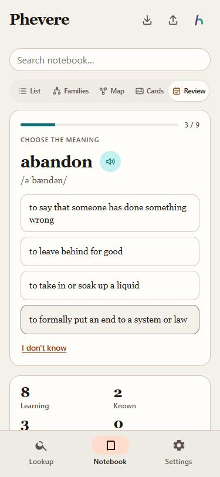

*A new word starts with picking its meaning out of four, the wrong ones taken from other saved verbs.*

## How the main apps review words

**Anki** has offered FSRS as its scheduler since version 23.10 ([release notes](https://github.com/ankitects/anki/releases/tag/23.10)). FSRS keeps three numbers per card: retrievability, the chance you recall it right now; stability, the days until that chance falls to 90%; and difficulty, which sets how fast stability grows ([ABC of FSRS](https://github.com/open-spaced-repetition/awesome-fsrs/wiki/ABC-of-FSRS)). The learner still grades each card with Again, Hard, Good or Easy, and the default desired retention is 90% ([deck options manual](https://docs.ankiweb.net/deck-options.html)). The manual has to remind people that Hard is a pass, which says something about how confusing four self-ratings are.

**Duolingo** grades automatically from whether the exercise was answered correctly. Its scheduler, half-life regression, estimates how long each word lasts in a learner's memory from their practice history. It cut prediction error by more than 45% against Leitner-style baselines and raised daily engagement by 12% ([Settles and Meeder 2016](https://aclanthology.org/P16-1174/)). The Practice Hub has Mistakes and Words sections built on it ([Duolingo blog](https://blog.duolingo.com/guide-to-duolingo-practice-hub/)).

**Memrise** grades automatically too. A right answer moves a word to a longer interval, from 4 hours up to 6 months, and a wrong one sends it back to 4 hours ([help](https://explore.memrise.com/help)). Learners can put typing tests first, and Speed Review gives about six seconds a word ([product news](https://memrise.com/blog/product-news-oct21)).

**Quizlet Learn** mixes typed answers, multiple choice and know-or-don't-know cards, and schedules the items least likely to be recalled using a power-law forgetting model ([Quizlet's 2018 paper](https://arxiv.org/abs/1803.00111)). Quizlet says Learn moves you from multiple choice to written questions; I could not open that page to confirm the wording.

**WaniKani** never asks for a self-rating. Answers are typed, items climb nine stages from Apprentice to Burned over intervals of 4 hours to 4 months, and a wrong answer drops them back ([SRS stages](https://knowledge.wanikani.com/wanikani/srs-stages/)). WaniKani refuses multiple choice because with it "you don't actually have to recall anything" ([FAQ](https://knowledge.wanikani.com/wanikani/multiple-choice/)).

**Lingvist** shows an example sentence with a gap and you type the missing word, with hints on request. It schedules the next review for when predicted recall drops to about 80% ([how it works](https://lingvist.com/blog/learn-with-lingvist-in-three-easy-steps/), [spaced repetition](https://lingvist.com/blog/spaced-repetition-in-learning/)).

**Vocabulary.com** runs rounds of ten questions drawn from ten question types, among them picture, synonym and real-world example questions. Difficulty adapts with item response theory, so learners get harder questions as they answer basic ones ([how it works](https://www.vocabulary.com/how-it-works/), [the science](https://www.vocabulary.com/membership/science-of-vocabulary/)).

Six of the seven grade the answer themselves. Only Anki asks the learner to rate their own memory, and Anki is a general flashcard tool, not a vocabulary app.

## What the research says

Testing beats rereading. In [Karpicke and Roediger 2008](https://pubmed.ncbi.nlm.nih.gov/18276894/), once students could recall a word, more study did nothing for recall a week later, while more testing had a large effect. In [Roediger and Karpicke 2006](https://doi.org/10.1111/j.1467-9280.2006.01693.x) rereading won at five minutes and lost at two days and a week, even though it made students more confident. The old Review screen showed the word and then the meaning, which is closer to rereading than to a test.

Spacing matters, and the best gap grows with how long you want to remember ([Cepeda et al. 2006](https://doi.org/10.1037/0033-2909.132.3.354), [Cepeda et al. 2008](https://doi.org/10.1111/j.1467-9280.2008.02209.x)). That is what an expanding schedule tied to a target retention does.

Harder practice that feels worse often teaches better ([Bjork and Bjork 2011](https://bjorklab.psych.ucla.edu/wp-content/uploads/sites/13/2016/04/EBjork_RBjork_2011.pdf)). Producing an answer beats recognising it: across 86 studies the generation effect was d = 0.40 ([Bertsch et al. 2007](https://doi.org/10.3758/bf03193441)). For vocabulary, [Laufer and Goldstein 2004](https://doi.org/10.1111/j.0023-8333.2004.00260.x) found a fixed order of difficulty across 435 learners: recognising the meaning of a word is easiest, then recognising the word for a meaning, then recalling the meaning, then recalling the word itself.

Multiple choice still has a place if it is done well. Wrong options can stick as false memories, and more of them makes it worse ([Roediger and Marsh 2005](https://doi.org/10.1037/0278-7393.31.5.1155)), but plausible, competitive options make learners retrieve and even help them remember the wrong options' own material ([Little et al. 2012](https://doi.org/10.1177/0956797612443370)). Feedback after a choice question removes most of the false-memory cost ([Butler and Roediger 2008](https://doi.org/10.3758/mc.36.3.604)). Delayed feedback helped in some lab studies ([Butler, Karpicke and Roediger 2007](https://doi.org/10.1037/1076-898X.13.4.273)), but for adults the advantage disappeared once the time to the test was controlled ([Metcalfe, Kornell and Finn 2009](https://doi.org/10.3758/MC.37.8.1077)), so showing the answer right away is fine.

Response time carries information. A scheduler that used both accuracy and response time beat fixed schedules on immediate and delayed tests ([Mettler, Massey and Kellman 2016](https://doi.org/10.1037/xge0000170)). FSRS itself does not take answer time as input ([FSRS contributor on the Anki forum](https://forums.ankiweb.net/t/several-fsrs-related-suggestions/44673?page=4)), so time has to be folded into the grade before FSRS sees it. A picture next to the word gives a second route to recall ([dual coding](https://en.wikipedia.org/wiki/Dual-coding_theory)), and the notebook already has one for every word.

## Sessions, ladders and charts in the mature apps

2026-11-04. The first version of Learn answered the question "how should a word be tested". It did not answer how a session is built, what happens to a word that keeps failing, or what the charts are for. This section looks at those questions across Anki with FSRS, WaniKani, Duolingo, Memrise, Quizlet Learn, Lingvist, Vocabulary.com, Clozemaster, 墨墨背单词 (MaiMemo), 百词斩 (Baicizhan), 不背单词 (Bubei) and 扇贝单词 (Shanbay). Baicizhan, Bubei and Shanbay publish little about their design, so what is said of them comes from reviews and how-to pages.

### How a session is built

Every app puts due reviews first and caps new words. Anki defaults to 20 new cards and 200 reviews a day, and its review limit also holds back new cards; the manual advises against adding new cards while reviews are overdue ([deck options](https://docs.ankiweb.net/deck-options.html)). MaiMemo deliberately has no fixed number of new words: when more reviews are due it hands out fewer new ones, because a fixed quota lets the pile of reviews grow until people quit ([MaiMemo docs](https://memodocs.maimemo.com/docs/TXhHwrM8Ei5QKjk562mcq8uInef)); its reviews come first, most forgotten first ([docs](https://memodocs.maimemo.com/docs/PulqwOB1xi5jV0kb8Y1cPE7ZnKc)). Lingvist shows no new words until every word at risk has been reviewed ([help](https://lingvist.com/help/why-do-i-see-new-words/)). Sessions come in short, countable pieces: Bubei works in groups of ten words and asks whether to go on ([sspai](https://sspai.com/post/87587)), Clozemaster and Vocabulary.com work in rounds ([Clozemaster FAQ](https://www.clozemaster.com/faq), [Vocabulary.com](https://www.vocabulary.com/how-it-works/)), and Duolingo lessons have a progress bar and an end.

### The exercise ladder

Quizlet Learn starts with multiple choice and moves to written questions as answers come back right, because early multiple choice can be passed by elimination ([how Quizlet works](https://quizlet.com/features/how-quizlet-works)). Baicizhan teaches a new word in three steps, from a picture chosen for an example sentence to the Chinese meaning, and a miss sends the word back a step ([woshipm review](https://www.woshipm.com/evaluating/3923886.html)). Duolingo's Birdbrain model picks the exercise a learner should find just hard enough ([Duolingo blog](https://blog.duolingo.com/learning-how-to-help-you-learn-introducing-birdbrain)). Clozemaster gives typed answers twice the points of multiple choice ([docs](https://docs.clozemaster.com/article/103-how-do-points-work)). None of them picks the kind of question at random.

### Leeches

Anki tags a card that has lapsed eight times as a leech and suspends it ([manual](https://docs.ankiweb.net/leeches.html)). WaniKani has no built-in leech handling; its community scores leeches by wrong answers over the current streak ([forum](https://community.wanikani.com/t/userscript-wanikani-dashboard-leech-tables-notice-your-leeches/33124)), and its Extra Study mode drills the last day's mistakes without counting them against the schedule ([help](https://knowledge.wanikani.com/widgets/extra-study/)). Vocabulary.com keeps a Trouble Words list and brushes those words up more often ([help](https://www.vocabulary.com/help/tracking-progress/monitoring-your-trouble-words)).

### Overrides

Five of the apps let you declare a word known: MaiMemo's 熟知, Baicizhan's 斩 (tapped again to undo), Shanbay's 太简单, Memrise's Known and Lingvist's mute ([MaiMemo](https://memodocs.maimemo.com/docs/Ok6YwF2X7iJZvvkCunjcmWwLnzb/), [Baicizhan](https://jingyan.baidu.com/article/09ea3edec060ad81afde3949.html), [Lingvist](https://lingvist.com/help/can-i-skip-certain-words/)). Quizlet offers "Override: I was correct" after a typed answer was marked wrong. Anki undoes the last answer with Ctrl+Z. Lingvist decides from the letters' positions whether a slip is a typo ([help](https://lingvist.com/help/how-do-you-count-mistakes)); WaniKani's matching is reported as too loose, accepting "north" for "south".

### Several books

MaiMemo keeps one pool of words and treats its books as ways of sorting it: a word learned in one book is learned in every book, with one history and one next review ([docs](https://memodocs.maimemo.com/docs/Y0iDwaZYeixhnzkuqJRcOEt6ncc/)). Shanbay instead filters a newly added book against your history once ([baidu](https://jingyan.baidu.com/article/ea24bc39774c019a62b331fe.html)).

### Charts

Anki's statistics answer questions a learner acts on: the future due forecast says whether to add new cards today, true retention says whether the scheduler meets its target, and the FSRS simulator forecasts the daily load for given limits ([stats manual](https://docs.ankiweb.net/stats.html)). MaiMemo shows a forgetting curve, the review load ahead and a distribution of how durable each word's memory is ([App Store](https://apps.apple.com/us/app/id888483369)); Shanbay shows how each book's words spread across familiarity levels. One review notes that Baicizhan and Bubei chart nothing ([woshipm](https://www.woshipm.com/evaluating/4425622.html)).

### What Phevere took, and what it left

Phevere took these, each for a reason it can name:

| Practice | Taken from | Why |
|---|---|---|
| New words fall as the review load grows | MaiMemo, Anki's review limit | The user's own complaint about long sessions is the failure MaiMemo describes |
| Rounds of twenty words with a clear end | Bubei, Clozemaster, Duolingo | A backlog of 4,801 words should never be one endless session |
| A ladder by memory strength, moving up within a session | Quizlet Learn, Baicizhan | Picking the kind at random gave the user 21 listening questions out of 44 |
| A skill balance with listening capped | None directly; Duolingo's "right difficulty" idea | Listening is the weakest signal of knowing a word and was half of a session |
| Leeches held at the learning stage and listed | Anki, Vocabulary.com | Drilling the same failing format again is what does not work |
| "Too easy" and "Already know it" | Shanbay, Baicizhan, MaiMemo | One tap for a word that wastes your time |
| One card per word across books, new words from one pool | MaiMemo | Phevere already kept progress per word; the books were still drawn separately |
| Charts that answer a question, with readouts | Anki, MaiMemo, Shanbay | The old charts had no axes and said nothing on a tap |

It left out an undo after Continue. Nothing is saved until Continue, and before that "I knew it", "I didn't know it" and "Too easy" already overturn the grade, which covers the slip Anki's undo is for; undoing a saved answer would mean deleting from an append-only history that other devices replay. It left out suspending a leech, because a word you saved is a word you want, and it left out a separate mistakes drill, because a leech already comes back in the easier format. Fitting FSRS parameters to your own history waits until there are a few hundred answers.

## Stages, adaptive questions and dictation

2026-11-05. Learn moved every word up a fixed ladder by its memory strength, and a word was either "Known" or "Learning" on the plan. This section looks at how mature apps and the research describe a word's progress, how they choose a question's difficulty, and what they do about listening and spelling.

### Stages of a word

Anki gives every card a stage. New cards have never been studied, learning cards were seen recently and are still in their first steps, review cards have finished learning, and relearning cards are review cards that were forgotten. A review card is young while its interval is under 21 days and mature from 21 days on ([Anki manual](https://docs.ankiweb.net/getting-started.html)). FSRS describes memory by stability, the number of days until recall falls to 90% ([the algorithm](https://github.com/open-spaced-repetition/awesome-fsrs/wiki/The-Algorithm)). Anki still draws the young and mature line on the interval. A thread on the Anki forum proposes drawing it on stability instead, because the interval moves whenever desired retention changes; no version of Anki does this yet ([forum](https://forums.ankiweb.net/t/maturity-based-on-stability/51718)). WaniKani has nine stages from Apprentice to Burned ([SRS stages](https://knowledge.wanikani.com/wanikani/srs-stages/)).

### Choosing how hard a question is

Duolingo's Birdbrain estimates both the learner's ability and each exercise's difficulty, predicts the chance of a right answer, and gives exercises of "just the right difficulty" ([Duolingo blog](https://blog.duolingo.com/learning-how-to-help-you-learn-introducing-birdbrain/)). Its blog states no target rate. Luis von Ahn gave about 70% as an example in an interview ([VentureBeat](https://venturebeat.com/ai/how-duolingo-uses-ai-in-every-part-of-its-app)). Wilson and colleagues derive an optimal training accuracy of about 85% for a class of learners trained by gradient descent ([Wilson et al. 2019](https://doi.org/10.1038/s41467-019-12552-4)), and Wilson says it fits perceptual learning best; I found no study of the best accuracy for vocabulary, so 85% is an extrapolation. Rating learners and items together in this way is the Elo method that adaptive learning systems use widely ([Pelánek 2016](https://doi.org/10.1016/j.compedu.2016.03.017)). Half-life regression, Duolingo's earlier model, predicts recall from practice history ([Settles and Meeder 2016](https://aclanthology.org/P16-1174/)).

### New words a day

Anki's manual says 20 new cards a day lead to roughly 200 reviews a day, which is the source of the rule of thumb of ten answers per new card ([deck options](https://docs.ankiweb.net/deck-options.html)). Anki does not compute a number of new cards from a learner's results; its review limit also holds back new cards, and a forum answer shows how to use that so Anki gives exactly as many new cards as the review cap allows ([forum](https://forums.ankiweb.net/t/how-many-new-cards-can-be-studied-every-day-while-the-workload-stays-the-same-long-term/69218)). MaiMemo's study amount is reviews plus new words, so a heavy review day leaves fewer new words. I found no app that suggests a number from the learner's results.

### Dictation and letter cues

I found no randomised study that compares dictation training with listening by multiple choice. Word recognition measured by partial dictation predicted about half the variance in listening comprehension among 167 Chinese learners ([Matthews and Cheng 2015](https://doi.org/10.1016/j.system.2015.04.015)). Duolingo's early listening exercises show the words alongside the audio and later ones are audio only, including typing a missing word you hear ([Duolingo blog](https://blog.duolingo.com/covering-all-the-bases-duolingos-approach-to-listening-skills/)). The general finding that producing an answer teaches more than recognising one (Bertsch et al., above) points the same way: picking from four lets a learner recognise the word by elimination, while dictation makes them hold its sound and spelling.

Showing some of the answer's letters and showing fewer as the learner improves is called diminishing-cue retrieval practice. Diminishing letter cues gave the best final recall in [Finley et al. 2011](https://doi.org/10.1016/j.jml.2011.01.006); they help most on hard items without feedback and match plain retrieval when feedback follows ([Fiechter and Benjamin 2018](https://doi.org/10.3758/s13423-017-1366-9)). Typing a word from its meaning is the hardest of Laufer and Goldstein's four levels of knowing a word, and recalling the meaning best predicted classroom performance ([Laufer and Goldstein 2004](https://doi.org/10.1111/j.0023-8333.2004.00260.x)), so spelling every word is not required to know it. 不背单词 lets a learner spell only the words they missed, with separate switches for spelling after study and after review ([App Store](https://apps.apple.com/cn/app/id698570469)).

### What Phevere took, for stages and adaptive questions

| Practice | Taken from | Why |
|---|---|---|
| New, learning, relearning, young and mature, the line at 21 days | Anki | The user asked that a word never be only new or learned |
| The line drawn on stability, not the interval | The Anki forum proposal | Stability is what FSRS knows about memory, and it stays put when retention settings change |
| The kind of question chosen to be right about 85% of the time | Birdbrain, Wilson et al. 2019, Elo | A word met at different strengths gets questions of different difficulty, which the user liked |
| Picking the word you hear early, dictation later | Duolingo's listening ladder | The user found multiple-choice listening too easy |
| Letter count, the first letter, Hint for one more | Diminishing cues, Memrise's hint button | The answer stays mostly the learner's own; a weak word gets an easier kind instead of a longer cue |
| A near miss counted as a miss, hinted answers worth less | Quizlet, Lingvist, SuperMemo's grade scale | A typed question asks for the spelling; a word that was given is not recalled |
| The word for a sentence's gap from four, the word from its letters | Duolingo, 百词斩, Memrise | Words in context, and a step between recognising a word and typing it |
| Fewer typed questions for a learner who misspells | 不背单词's spelling switches, Laufer and Goldstein | Not every word has to be spelled to be known |
| Fewer new words on a heavy day, a suggested number from the usual day | Anki's review limit and rule of thumb, MaiMemo | The number of new words should fit the time the learner actually spends |

## What Phevere does now

### A day's plan and its rounds

Today's plan is every word due by the end of today, most overdue first, with today's new words spread among them. My words gives its own new words, oldest saved first, up to its daily goal. A word book gives words from the pool described under "Word books as one pool". While due reviews are at most five times the daily goal, the whole goal is given; beyond that each five more reviews hold back one new word, and at ten times the goal no new word comes until the reviews are done. Once Phevere knows how much you usually study (see "Adapting to the learner"), today's new words also have to fit beside today's reviews in a usual day's answers, with a fifth to spare, so a heavy day gets fewer and a light day the whole goal. In All books, My words and the books share that room by their goals. The room is for the whole day: the answers already given today count against it (`answersToday` in `studyPace`, which each shell adds to as answers are saved), so another round after the first batch plans no new batch. The start card says how many new words wait until the reviews are done and how many wait for tomorrow.

A session takes the first twenty words of the plan as a round. The start card shows the round as learning, review and new words with an estimate of the time, and how many more words today has. A round ends with how many answers were given, the share right, the time, the words due tomorrow, the new words started, the words that moved up or slipped back a stage, and the words missed, each of which opens in lookup. Next round plans again from what is due now.

A question always asks, answers and records the word it was built for; it never shows another headword in its place. Two headwords count as one word only by a strict rule (`regularForms` in `review-quiz.ts`): the regular -s, -es, -ed and -ing endings, with a final e dropped, y turned to i, and a consonant doubled only before -ed and -ing in a one-syllable word, plus British and American spellings such as "colour" and "color". -er, -est and -ly are left out, because they make other words: "leader" is not "lead", "forest" is not "fore", and "rate" is not "rat". No choice question offers two forms of one word. Two saved entries are asked once in a session only when, beyond the spelling, one entry is listed as a form of the other ("simple past of glean") or their meanings are mostly the same; then the word itself, or the entry with a usable sense, is kept. Words of a word book are never folded together, since each book lists its own headwords. Confusable words such as "principal" and "principle", or "advice" and "advise", stay apart and make good wrong options.

### Stages

Every word has one of Anki's stages (`wordMaturity` in `review-quiz.ts`): new until its first answer, learning in its first steps, relearning after a lapse, young while FSRS stability is under 21 days, and mature from 21 days. The line is drawn on stability rather than the interval, so changing the desired retention does not move words between young and mature. Words saved before FSRS use their old interval. The stage is tagged on every question, the plan beside the quiz counts words per stage, the forecast of reviews splits by stage, and a round's summary lists the words that moved up a stage ("Young → Mature") or slipped back ("Mature → Relearning").

### The ladder

Each stage opens a set of kinds, in an order that follows Laufer and Goldstein from the easiest kind of knowledge to the hardest:

| Stage | When | Kinds it may ask |
|---|---|---|
| 0 | New, first time today | Pick the meaning; pick the word |
| 1 | Learning, relearning, a new word asked again today, or a leech | Pick the word; pick the word for the gap; pick the meaning; pick the word you hear; spell it from its letters; type the word |
| 2 | Young: in review, stability under 21 days | Type the word; pick the word for the gap; pick the word; fill the gap; spell it from its letters; type the word you hear; pick the word you hear |
| 3 | Mature | Fill the gap; type the word; type the word you hear; pick the word for the gap; pick the word; pick the meaning |

The stage is the one the word's tag shows (`wordMaturity`), so a word tagged Young is asked from the Young row even when it is held for only a few days; the predicted chance below still steers a shaky word towards the easier kinds. Picking the word you hear belongs to the early stages and typing the word you hear, dictation, to the later ones. A new word asked again in its first session is recognised again, never typed or built from its letters, so spelling waits for a later day. A leech is asked in the recognition formats and may be built from its letters, but is never typed.

Within the stage the kind is the one the learner should get right about 85% of the time (`chooseKind`, `TARGET_SUCCESS`). The predicted chance of a right answer (`successChance`) adds up, in log-odds, how firmly the word is held now (FSRS's predicted recall, an even chance for a new word), how easy the kind is (`KIND_EASE`: picking a meaning +1.8, picking the word +1.4, picking the word for a gap +1.3, picking the word heard +1.1, building it from its letters +0.8, typing it into a gap +0.1, typing 0, dictation -0.5), and what the learner's own answers say about that kind (see "Adapting to the learner"). A shortfall from 85% costs twice as much as an excess, because a miss sends the word back to relearning while an easy question still makes the learner retrieve it. So a young word due today is typed, the same word long overdue steps back to picking it from four, and a word held for weeks is filled into a sentence or written from dictation: one word meets questions of different difficulty as its memory changes.

The session's skill balance still applies. A kind whose skill the session already leans on more than the aim costs more (meaning 50%, spelling 35%, listening 15% by default), repeating the last kind costs a little, and listening is never more than a fifth of a session nor in its first four questions. The spelling aim moves with the learner: from 15% for a learner whose typed answers go wrong more often than predicted to 45% for one who spells well, so not every word has to be spelled. In a 40-day simulation a learner who spells poorly never typed about a sixth of the words started in the first fortnight.

A gap question uses a sentence from your note, then the sentence the word was saved from, then the dictionary's example sentences, which the apps look up a few words ahead for every word already started. Typing into the gap is the hard form. Picking the word for the gap from four (`cloze-choice`) is the easy one, as in Duolingo's "Select the missing word" and 百词斩's example sentences: the three wrong options are other saved words in the form the gap takes (`inflectLike`), so for "Lanterns hung from every branch" every option is a plural starting with a capital, and a word that cannot take that form is left out. The wrong options share the answer's part of speech when both are known, and a gap in an inflected form takes only words whose part of speech is known (verbs for -ed and -ing), so no option is a made-up form such as "appling". A word that the answer's definition names, or whose definition names the answer, is never a wrong option, because a synonym could fill the gap too. It has the countdown of the other choice questions. A word without a sentence never gets a gap question.

### Spelling from letters

Spelling the word from its letters (`spell-tiles`) shows the meaning, a slot for each letter, and the word's own letters shuffled in a row, as 百词斩's spelling drill and Duolingo's word bank do. A tap places a letter in the next slot, a tap on a placed letter takes it back, and the used tile leaves its place empty so the row never shifts. With a keyboard, a letter key places the first unused tile with that letter and Backspace takes the last one back. Placing the last letter answers the question. Any wrong order is a miss, since the tiles hold only the word's letters. A quick right answer is Good, never Easy, because the letters were given. It needs a word of 3 to 14 letters with no space, and it opens after three words have been recognised. In the 40-day simulation a weak speller's typed answers were right 58% of the time without it, once the cue was one letter. With it, most of their spelling moved to the letters, right 74% of the time, and the words they still typed were right 71% of the time.

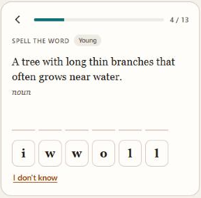

*The word is built from its own letters, one tap a letter.*

### Letters shown and Hint

A typed question shows the answer's length as one dot per letter, with "7 letters" under the box. Typing the word and filling the gap show its first letter, and dictation none, however weak the word is (`cueLetters`). Until 2026-11-06 a weaker word got up to a third of its letters up front, so a long word could open with four; now a weak word gets an easier kind of question instead, such as building it from its letters, and the answer typed is mostly the learner's own.

Each Hint gives one letter: the one after the letters the learner already has right, or after the letters shown so far. When the box holds the start of the answer, the letter is added after it. When it holds anything else, the box is left as typed and the letters shown appear under it. Hint never gives the last letter, and it never clears anything. The box itself is kept on every keystroke (`keepDraft`), so a repaint of Learn, from a word that finished playing, a sync or a picture that loaded, puts back exactly what was typed. Before, any repaint emptied the box, and a dictation repainted the moment its word finished playing.

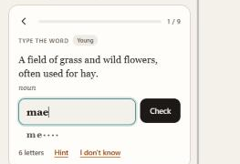

*The learner typed "mae" and pressed Hint: the box keeps "mae", and the letters shown are under it.*

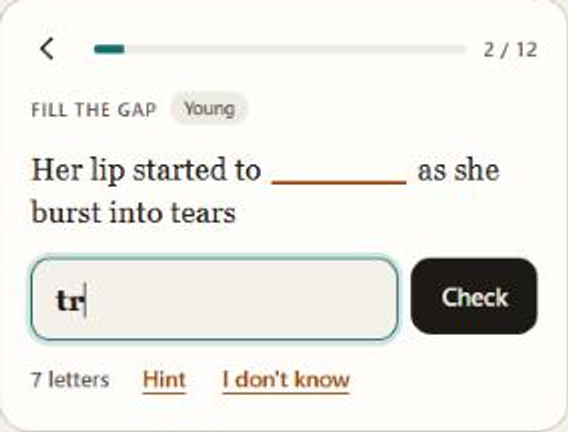

*After one Hint the box holds the first two letters, and the learner types the rest.*

### Unlocking

Harder kinds open for a learner after easier ones have gone right (`KIND_UNLOCK`): building a word from its letters after three right answers picking a word, a meaning or the word for a gap, typing after five right answers picking a word or a meaning, filling a gap after three right typed words, and dictation after three right answers picking the word heard or typing a word. Typed answers count because picking the word heard is never asked of a mature word, so a learner whose words are all mature would otherwise never reach dictation. Right answers in the current session count, so a new learner reaches typing during their first session.

### Senses a question can use

A question shows the first usable sense of the word (`bestSense`). Citation lines that some sources return instead of a sense ("↑ "idiosyncracy", in Dictionary.com Unabridged…"), "plural of" and "past tense of" lines, and text that is only Wiktionary style rules are not usable; "Alternative form of mock-up. [A scale model…]" uses the bracketed gloss. An everyday sense comes before a dialect, obsolete or rare one, so "shed" asks "to part with, cast off" rather than its UK dialect sense. A sense is never cut short. When the first everyday sense runs past 160 characters (`PROMPT_CHARS`) and one of the next two is shorter, the shorter one is asked; otherwise the long one is shown whole. "Funnel" now asks "A passage or avenue for a fluid or flowing substance." instead of its cone-shaped utensil sense cut off after "typically used when…".

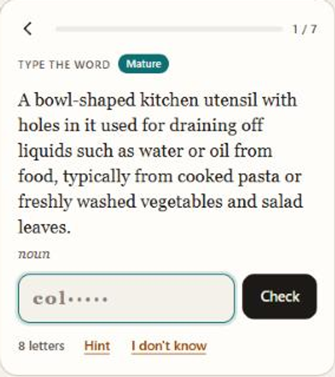

*A long sense with no shorter one is shown whole.* A word with no usable sense is skipped unless a sentence can be found for it; it is never pushed into listening instead. A word with no senses at all, such as a book word whose lookup failed, gets the plain card: the word, then its pronunciation, picture and Open in lookup. Before a round starts, the apps look up the meaning of every book word in it, so the plain card is the exception.

### Grading and overrides

The answer is graded automatically and mapped to FSRS's four grades, so the learner never rates their own memory:

- A wrong answer is Again. So is a typed answer one letter off in a word of five letters or more (two letters in ten or more), shown as "Almost" with the right spelling and the cross. A typed question asks for the spelling, and Quizlet and Lingvist count a misspelt answer as missed too.
- A right choice is Good, or Hard after ten seconds. Recognition never earns Easy, and neither does a word built from its letters.
- A right typed answer is Easy within 2.5 seconds plus a quarter second per letter, Hard after 15 seconds plus that allowance, and Good in between.
- Hints lower that by how much of the word they gave (`hintShare`, the letters Hint gave over the letters the learner had to supply). Any hint makes the answer Hard at most, and hints for more than a third of the hidden letters (`HINT_FAIL_SHARE`) make it Again, since the word was told rather than recalled. One hint in "idiosyncrasy" is Hard; four are Again. The learner model counts a hinted answer as only partly right, by the same share.

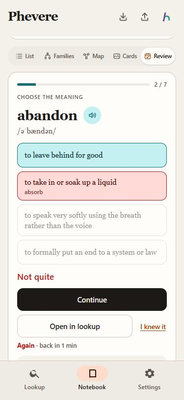

*After a miss, the chosen option names the word it belongs to, and "I knew it" overturns the grade.*

One tap overturns the grade before Continue saves it: "I knew it" after a miss makes it Good, and after a near miss or an answer that needed many hints makes it Hard; "I didn't know it" after a lucky guess makes it Again; and "Too easy" after a right answer without hints makes it Easy. A new word from any list can be set aside with "Already know it", which sits at the end of the instruction row, away from where Continue appears; the round's summary lists those words with Undo. Taps and keys in the first 0.4 seconds of a question are ignored, so a double tap on Continue cannot answer the next one. Back during an answer saves it first, as Continue would. The answer shows at once with the picture, the pronunciation, the saved senses and the note, and the line under the buttons says when the word comes back. Words due again within 20 minutes, Anki's learn-ahead limit, come back in the same session, up to three times. With a keyboard, on the desktop and on a phone or tablet that has one, 1 to 4 pick an option and Enter starts, continues or begins the next round; the key hints show only where a keyboard-like pointer exists.

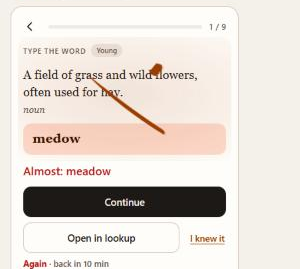

*A near miss gets the cross and Again; "I knew it" would make it Hard.*

### Leeches

A word with four lapses or more is a leech (`isLeech`). Anki's threshold is eight, but Anki's lapses come from the learner's own Again; here every miss counts, so the line is lower. A leech is asked at the learning stage whatever its stability, in the easier recognition formats, is tagged "Trouble word" on the question, comes back at most once more in a session, and is listed with its misses on the Progress page.

### Adapting to the learner

`packages/core/src/learn-adapt.ts` reads the answer history twice when Learn opens and again before each new round.

The learner model (`learnerModel`) keeps, for each kind of question, how much better or worse this learner does than predicted, in log-odds. It replays the history in time order, rebuilds each word's FSRS state as `replaySchedule` does, predicts each answer from the word's recall at that moment and the kind's ease, and moves the kind's offset by the surprise, an Elo update whose step starts at 0.4 and shrinks to 0.05 as answers of that kind accumulate. During a session each answer moves the offsets again from the question's own prediction, a hinted answer counting only for the share of the word the learner supplied. A learner who spells well gets more typed questions; one who misspells gets fewer, and more words to build from their letters. The history does not record hints, so past hinted answers count as fully right there, which makes a weak speller's offset a little kinder than the truth.

The study pace (`studyPace`) looks at the last fourteen days with answers within four weeks, leaving today out: the median answers a day, how many answers a new word took on its first day, and how often review answers were right. Following Anki's ten answers per new card, each new word a day later adds about 7.5 review answers to every day, more when reviews go wrong more often than the 90% the schedule aims at. The suggested number of new words a day is the usual day's answers divided by what a new word costs. When it differs from your goal by at least two words and a third of the goal, the start card says so, with a button that sets it ("8 new words a day fits your recent study time · Use 8"); All books, with several goals, gets no offer. With fewer than three study days there is no pace, and the plan follows the review-load rule alone.

In a simulation of 40 days at 70 answers a day (`scripts/test-learn-adapt.js`), words passed through every stage, more than half met three kinds of question or more, dictation came only for young and mature words, a weak speller got fewer typed questions than an average one, and about 70 answers a day led to a suggestion of five or six new words.

### One voice

A listening question plays the word once when it appears, and ▶ plays it again. Either plays the recorded clip when the word has one and the synthetic voice only when it has none (`singleVoice` in `pronounce-once.ts`). A newer press stops the older one, and the older one never starts a voice after that; before, a tap while the word was still being looked up could play the synthetic voice and then the recording. A recording that cannot be loaded is stopped before the synthetic voice speaks, so it cannot follow it.

Three more paths could still give two sounds until 2026-11-06, and each is closed. On the desktop the synthetic voice is made in the main process before it plays; a press that came while the voice for an earlier press was being made used to let both play, one after the other. The backend now gets `alive` and stays silent once a newer press has come. On Android a recording that started and then reported an error, or stalled for 20 seconds, counted as a failure, so the page tried the next recording and then the synthetic voice after the word had already been heard; a clip that has started now counts as played. And Continue, Back and every press now cancel whatever is still loading or playing for the question being left (`cancel`), so a word still loading never plays over the next question.

### The answer mark

The answer is marked on the question itself, over the instruction, the prompt and the options together: a brush tick for a right answer and a cross for a wrong one or an almost, each a tapered ink shape revealed by a pen line along its middle, over a soft wash of teal or rust. The right option fills and settles and a wrong pick gives a small shake. The whole mark takes about three seconds and takes no taps, so Continue works while it plays. A repaint resumes it from the time of the answer, so a picture or a meaning loading in the background no longer cuts it short.

Windows reports reduced motion when "Show animations" is off, and both apps turned every animation off then, which is why the mark never showed for some users. The mark now draws in that case too, with the lift, the settle and the shake left out.

### Word books as one pool

Progress belongs to the word, not to a book (see `wordbook-store.ts`): a word saved to My words is scheduled on its `vocab` row, and a book word on its `book_words` row, both keyed by the lowercase headword. So a word known through My words counts as known in 考研 and every other book that lists it, and an answer in any list updates it everywhere.

New book words are picked across the scope's books as one pool (`pickNewBookWords`). Each book offers its words at its own level first: a word of 考研 or CET-4 that Starter, 中考 or 高考 already teach waits until the book's own words run out, because the learner most likely knows it. Book order alone started 考研 with state, might, part, against and system; it now starts with federal, republican, congress, democratic and executive. Within that, words that share a root or a stem with a word you saved or started ("nationality" after "nation") and words more of your books list move a little forward, and each book's daily goal still sets how many words the pool gives.

For words that slip through, the choice was between this level filter and a placement pass, the quick "know it or not" triage that 不背单词 and MaiMemo offer when a book is added (MaiMemo's 熟知 also marks words known one at a time). The level filter costs the learner nothing before the first question and is right for most of a graded book, while a placement pass costs minutes up front and asks the same question "Already know it" already asks in the round. So Phevere filters by level and keeps "Already know it", with Undo, as the triage. A new word's question is tagged with the books that share it. On Progress, each list says how many words it shares with the others and how many of its words were started through another list.

## The answer history

Every answer is also written to an append-only table, `answer_history` (`packages/core/src/answer-history.ts`), on the desktop and the phone. A row holds the headword in lower case, the `vocab` row id when the word is in My words, the word book being studied, the time, the question type, the skill it tested, whether it was right, the response time, the grade that was saved and the device. "Already know it" and its undo are rows too, with no grade. Rows are never changed or deleted.

The skill comes from the question type. Picking a meaning or a word, and the plain flash card, test meaning; typing the word from its meaning or into a sentence tests spelling; the two questions that play the word test listening. There is no speaking check, so the third skill is called Listening. A word's score in a skill moves halfway towards 1 after a right answer and halfway towards 0 after a wrong one, so two right answers in a row from scratch, or three after a miss, take it past 0.75, which counts as mastered.

The FSRS schedule can be rebuilt from the history. `replaySchedule` runs the graded answers in time order through the same `scheduleReview` call the live review uses, starting from a new card. ts-fsrs seeds its interval fuzz from the review time, the repetition count and the memory state, so the replay lands on exactly the state the live updates wrote; `scripts/test-review.js` checks this for a saved word, a book word and a word reviewed before the history existed. That last case is why a word's first graded row can carry a `prior`: the schedule as it stood just before, which replay starts from. `rebuildWordSchedule` writes the replayed state back to the word's `vocab` row, or to its `book_words` row when it is not in My words.

## The Progress page

Learn has a second page, Progress, built from the answer history and the words' FSRS state in `packages/core/src/learn-progress.ts`. It follows the list chosen in the Learn switcher, except the Words section, which always lists My words and every book. Every chart has a y axis with its unit, gridlines and labelled days, and a readout under it: pointing at a bar or a day, tapping it, or moving to it with the keyboard names it and lists its words, which open in lookup.

Since 2026-11-05 the page is set like a printed spread rather than a grid of equal cards. The streak is a giant numeral at the top with today's gauges beside it, and each section after it sits on an ink rule with a number and a label, led by one oversized number at a size of its own. On a wide window the sections pair up on twelve columns as seven and five; on a phone they stack.

Since 2026-11-06 every number sits below its rule and beside its label. Before, the Memory and Answers numbers rose through their rules on purpose and the masthead numeral ran into the sentence beside it, which read as a mistake. Each big number now carries its length (`--ch`) and takes the smaller of its usual size and what its column can hold, measured with CSS size containers on the page and on each section, so a four-digit streak or a notebook of thousands of words shrinks to fit instead of overflowing. The sentences became labels: "Day streak" with "Best 3", "Remembered" with "of 37 words" and "20 due", "Due in 7 days", "Mature" with "of 36 started", and a third gauge, Right, once today has answers.

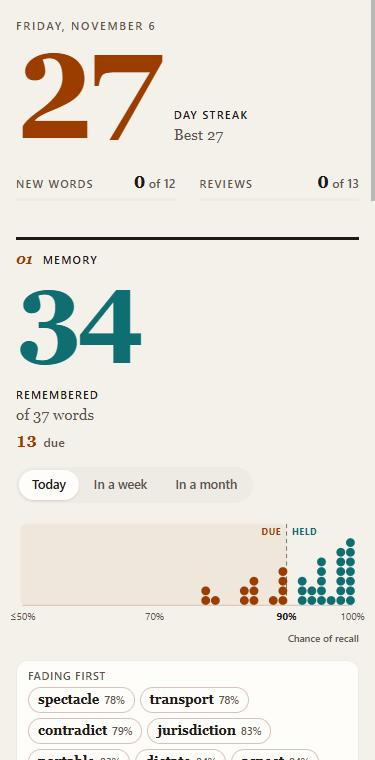

*The top of Progress on a phone: the streak and its label, today's gauges, and Memory.*

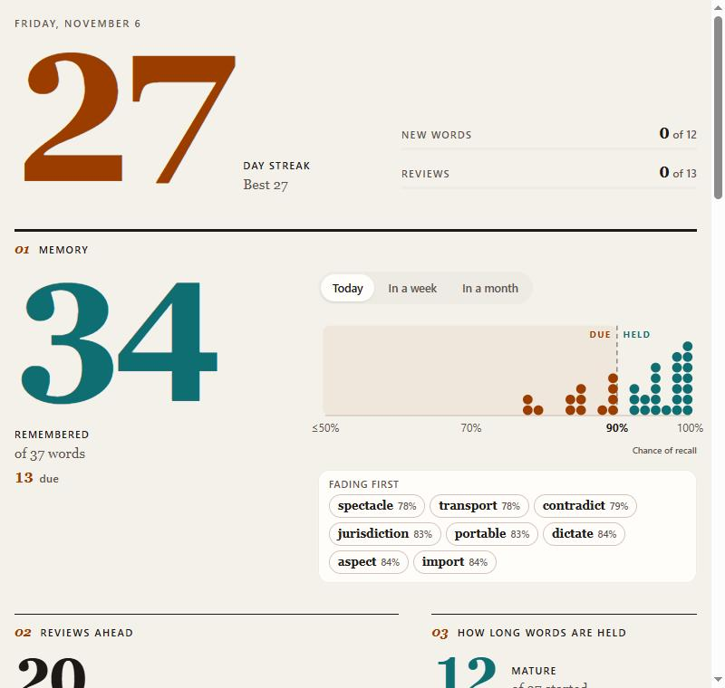

*In a wide window the gauges sit beside the streak, Memory's number and labels sit beside the strip, and the next sections pair up seven to five.*

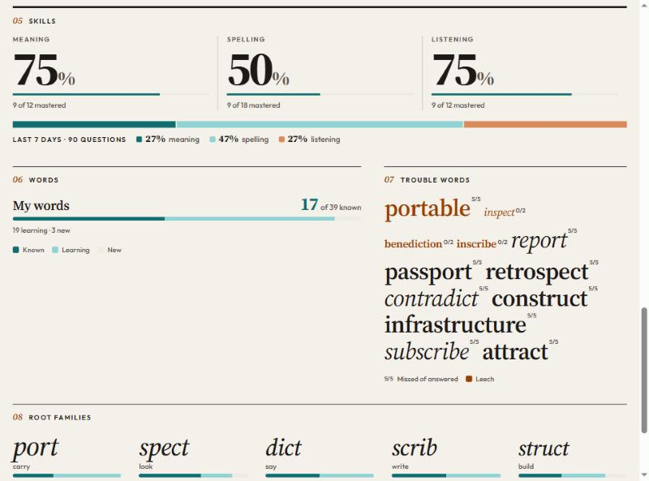

*Skills as small multiples, trouble words sized by how often they were missed, and root families sized by how many words they gather.*

The sections answer one question each:

| Section | The question it answers |
|---|---|
| Masthead | How long is my streak, and how far am I through today's new words and reviews? |
| Memory | How many of my words would I recall today, in a week or in a month without review, and which fade first? |
| Reviews ahead | How busy are the coming days, and with which words? Bars split learning words, words held under three weeks and words held longer. |
| How long words are held | How many words are at each stage (New, Learning, Young, Mature), the same stages Today and the question tags show? |
| Answers per day | How much did I study each day, how much was right, and for how long? |
| Skills | How many words are mastered in meaning, spelling and listening, and what was last week's mix of question kinds? |
| Words | How far am I through each list, what does it share with the others, and how much of it did I learn elsewhere? |
| Trouble words | Which words do I keep missing? |
| Root families | How much of each root family do I know? |

New words today counts words whose first graded answer fell today, against the sum of the daily goals in the list. Reviews counts today's graded answers against those plus the reviews still due. The streak counts days in a row with at least one answer, ending today or, before today's first answer, yesterday. A word's skill score moves halfway towards 1 after a right answer and halfway towards 0 after a wrong one, and 0.75 counts as mastered.

### Memory

Memory replaced "If you stop reviewing", which drew the average recall over a slider from 0 to 60 days. An average of 67% after fourteen days tells a learner nothing they can act on. What a learner can act on is a count of words and a date. Anki's "estimated total knowledge" is the sum of every card's chance of recall ([stats manual](https://docs.ankiweb.net/stats.html)), and MaiMemo shows how durable each word's memory is rather than one curve ([App Store](https://apps.apple.com/us/app/id888483369)).

So Memory leads with the number of words you would recall, which is that sum, labelled with how many words are in rotation and how many are below 90% and so due. The label says "Remembered" because the number is a prediction; "Recalled today" read as answers given today. Every word is a dot placed by its chance of recall, teal while it is held and rust once it is due. Today, In a week and In a month move the dots to where they would be without review, and the label then says how many fewer words you would recall and how many would be due, so the cost of a week off is a number. Pointing at or tapping a dot, or walking the dots with the arrow keys, names the word, its recall, when it was last reviewed and the date it falls below 90%. In FSRS that date is the last review plus the word's stability, since stability is defined as the days until recall falls to 90%. The words fading first are listed under the strip.

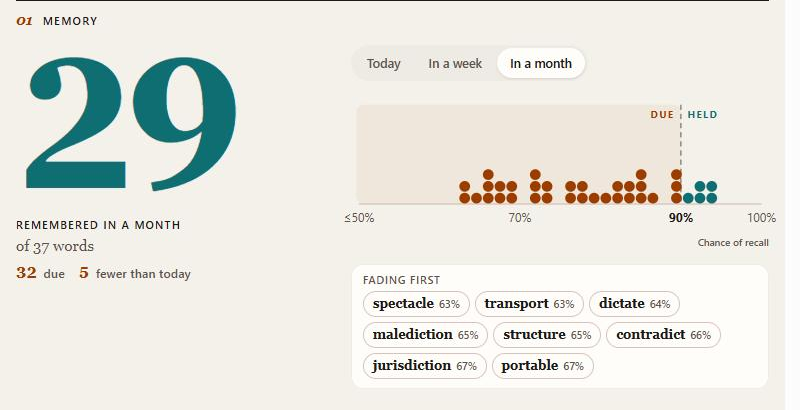

*In a month without review, most of the dots have crossed into the rust zone.*

### What the layout follows

Apple Fitness and Health lead each metric with one large number and a sentence about the learner's own trend. Spotify Wrapped sets numbers as shapes at many times the body size, and Strava's Year in Sport, designed by Manual, keeps its type, strips and circles simple enough to animate. Tufte's sparklines and the direct-labelling advice from Datawrapper and the EU data visualisation guide argue for labels on the data instead of in legends. Stats pages word those labels as names, not sentences: Apple Fitness puts Move, Exercise and Stand beside each ring's number, Duolingo's profile puts "Day streak" and "Total XP" under its numbers, and Strava puts Distance, Pace and Time under an activity's figures, so Progress does the same. The Pudding's notes on responsive graphics ask for charts that work on a phone first and for fixed annotations where hover is missing ([Pudding](https://pudding.cool/process/responsive-scrollytelling/), [Datawrapper](https://www.datawrapper.de/blog/better-more-responsive-annotations-in-Datawrapper-data-visualizations/), [Tufte](https://www.edwardtufte.com/notebook/sparkline-theory-and-practice-edward-tufte/)). The page keeps the app's three hues and its serif, Source Serif 4, at its display optical size for the numbers; the charts keep their readouts, so every bar and dot can still be pointed at, tapped and reached by keyboard.

The Today page has two charts of its own: reviews due over the next fourteen days, where tapping a day lists its words, and the words saved (in a book, started) per day over twelve weeks, with months along the top, weekdays down the side and each day's count and words on a tap. It shows the daily goal for new words as a fact, which opens Settings → Learn.

## Settings → Learn

Since 2026-11-05 the options for Learn live in Settings, on the desktop and the phone, and the Learn tab only shows what they settle. That is where every app we looked at keeps them: Anki's daily limits and timers are deck options ([manual](https://docs.ankiweb.net/deck-options.html)), Shanbay keeps 每日单词量 under 我的 and 学习设置, Duolingo keeps the daily goal and the speaking and listening switches in Settings, and WaniKani moved its daily lesson count to App Settings ([blog](https://blog.wanikani.com/posts/today-lessons-count-setting/)).

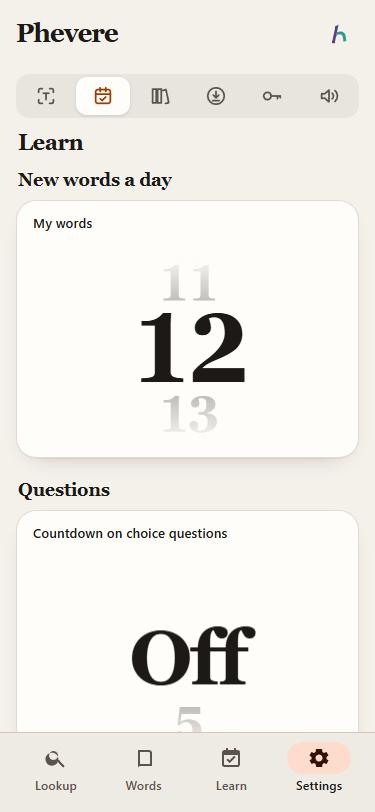

*Settings → Learn on a phone: a wheel per list and one for the countdown.*

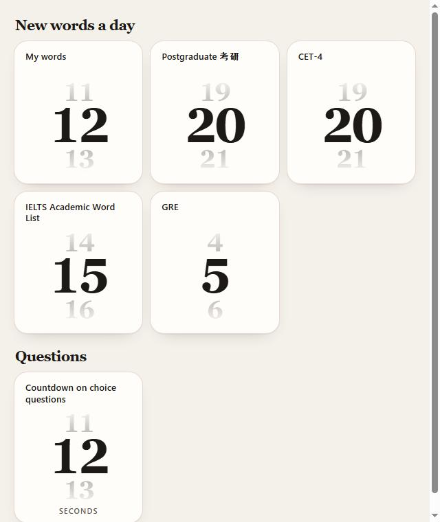

*The desktop Settings window: the cards wrap to as many columns as fit.*

New words a day has a card for My words and one for each word book you study, each with a number wheel from 1 to 999. Countdown on choice questions is a wheel that runs from Off through 5 to 30 seconds. Since 2026-11-06 the wheels replace the 5, 10, 20 and 40 buttons, the Other field and the countdown menu.

The wheel (`packages/core/src/number-wheel.ts`) follows the pickers people set numbers with every day: the iOS wheel picker and the timer and alarm pickers in iOS and Android's Clock, where you drag a drum of numbers and it settles on one, and Material 3's time input, where the large hour and minute numbers can be tapped and typed. The value in the middle is set large in Source Serif at its display size and heaviest weight; its neighbours turn away above and below, smaller, lighter and fainter, and each sits as far from the next as their sizes need, so two numbers never overlap while the wheel turns. At rest only the type marks the middle value; a soft rust band appears behind it while you hold the wheel, type into it or reach it with the keyboard. You can drag it or flick it, and a flick coasts and lands on a value with a slight spring. A mouse wheel moves one value a notch and a trackpad turns it continuously, but only when the scroll starts on the wheel; a page scroll that passes over a card keeps scrolling the page, the way browsers latch a scroll to the scroller it began in. Tapping above or below the middle steps one that way, and tapping the middle opens a field to type a number, which Enter or leaving the field keeps and Escape drops. From the keyboard it is a spinbutton in the WAI-ARIA sense ([APG](https://www.w3.org/WAI/ARIA/apg/patterns/spinbutton/)): the arrow keys step by one, Page Up and Page Down by 10 (5 on the countdown), Home and End go to the ends, and Enter, F2 or a digit opens the field. Keyboard steps do not animate. A value is saved once the wheel settles, or 350 milliseconds after the last key press, and saving does not repaint the page, so the wheel keeps focus. It reaches Learn as `learnPrefs` in `ReviewRenderOptions` (`packages/core/src/learn-prefs.ts`), and the countdown itself belongs to the question logic in `review-quiz.ts`. There is no switch for speaking questions, because none exist yet. The stored `speaking` preference and the microphone check (`microphoneAvailable`) are kept, and `SPEAKING_QUESTIONS` in `settings-learn.ts` turns the switch on once speaking questions are built; it will then appear only on a device with a microphone Phevere may use. The countdown applies to the questions answered by picking one of four (`COUNTDOWN_KINDS`): a thin bar under the instruction empties over the chosen seconds, and when it runs out the question counts as not known (Again) and says "Time is up" (`armCountdown`, `expireCountdown`). Only time on screen counts: a learner who opens Settings or another tab, or puts the phone away, comes back to the seconds that were left, and a repaint resumes the bar where it stood. On a question that plays the word, the bar stays full until the word has played or failed to load (`markHeard`, at most `COUNTDOWN_WAIT_MS`, 8 seconds). Typed questions have no countdown, since their time already sets the grade. A round under way is not restarted when a goal changes.

## What is left open

Automatic grading by time is a judgement call. If the thresholds feel wrong in use, they live in `autoGrade` in `review-quiz.ts`. The skill aims and the listening cap live in `SKILL_TARGET` and `LISTEN_CAP`, the leech line in `LEECH_LAPSES`, and the round size in `ROUND_WORDS`. The 85% aim (`TARGET_SUCCESS`), the ease of each kind (`KIND_EASE`), the worth of a letter (`LETTER_EASE`) and the unlock counts (`KIND_UNLOCK`) are first guesses from the literature, not fitted to Phevere's own answers; the answer history could fit them once it holds a few thousand answers, and recording the letters shown with each answer would make the learner model exact. FSRS can fit its parameters to a learner's own history once there are a few hundred reviews; the answer history holds what that fitting needs, but Phevere still runs on the default parameters. The question screenshots in this memo, other than those of hints, dictation and long prompts, show the Learn tab before the 2026-11-04 rebuild.
