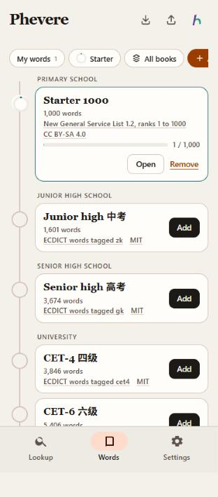
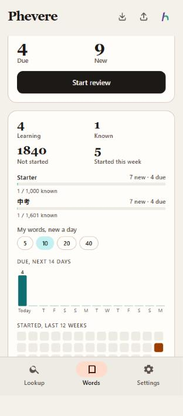

# Word books

2026-11-03. This memo records how Chinese vocabulary apps organise graded word lists, which lists exist for each level, which of them Phevere can legally ship in an MIT app, and what it ships. The data is built by `scripts/build-wordbooks.js` into `packages/core/wordbooks/`.

## What the apps call it and how they work

The Chinese apps call a graded list a 词书, a word book. 百词斩 uses 词书 in its store copy, MaiMemo users talk about 词书 and 云词本, and Shanbay says 单词书 in Chinese and `wordbook` in its own URLs (`/wordbook/books/mine/`). I found no better established English term, so Phevere uses "word book". The user's own list keeps its own name, "My words", and the whole area is called "Words".

All four apps follow the same pattern:

- The library is sorted by level, usually 小学, 初中, 高中, 四级, 六级, 考研, then 雅思, 托福 and GRE, with several books per level. MaiMemo covers 小学 to 考研 plus IELTS, TOEFL, GRE, SAT and medical books, and a 2019 review counted more than 600 books ([sspai](https://sspai.com/post/56641)). 不背单词 claims more than 200 ([App Store](https://apps.apple.com/us/app/id698570469)).
- You pick a book and set a daily plan. MaiMemo sets the day as reviews plus new words, with at least 10 new words. 百词斩 talks about a plan "按自己的节奏" ([App Store](https://apps.apple.com/us/app/id557545298)).
- Progress is shown per book as words learned out of the total.
- A personal list sits next to the books. Shanbay lets you upload your own list as a book and keeps a 生词本 with quick review ([App Store](https://apps.apple.com/us/app/id698013609)). MaiMemo lets you build a 云词本 from an article or from lookups.

I could not find public help pages for the plan screens themselves, so the details of "new words a day, days to finish" come from using the apps rather than from a cited page.

Phevere follows that pattern. The Words tab has a switcher with My words first, then each book you subscribed to, then All books, then "Add a word book", which opens the library ordered from primary school up.

<p align="center"></p>
<p align="center"><sub>The library on the phone. An added book shows its progress and an Open button; the others show Add.</sub></p>

Each book has its own daily goal for new words, set with My words' goal in Settings → Learn. The Learn tab has the same switcher without "Add a word book", and choosing a list in either tab chooses it in both. Review in Learn draws that many new words from the book in its order and mixes in every word due that day. A word learned once counts in every book that contains it, so in All books the plan panel lists each book's new and due words for today and how many of its words are known.

<p align="center"></p>
<p align="center"><sub>All books on the phone: one session across My words and two books, with a row per book.</sub></p>

## Which official lists exist

| Level | Official list | Size | Issued by |
|---|---|---|---|
| Primary and junior high | 义务教育英语课程标准（2022年版）附录 | about 500 words by the end of primary school and 1,600 by the end of junior high, plus 100 to 300 extension words per level | 教育部 |
| Senior high | 普通高中英语课程标准（2017年版2020年修订）附录 | about 3,000 words | 教育部 |
| University | 全国大学英语四、六级考试大纲（2016年修订版）词汇表 | the 2016 revision was the first to include a word list | 教育部教育考试院 ([syllabus page](https://cet.neea.edu.cn/html1/folder/16113/1588-1.htm)) |
| Postgraduate entrance | 全国硕士研究生招生考试英语（一）考试大纲 词汇 | 5,530 words in the 2024 edition | 教育部教育考试院 |
| IELTS and TOEFL | none published | | |

Neither IELTS (British Council, IDP, Cambridge) nor TOEFL (ETS) publishes an official vocabulary list. The "雅思词汇" and "托福词汇" books sold in China are compilations by publishers.

## What may be shipped

Article 5 of the Copyright Law of the People's Republic of China (2020 revision, [text](https://zh.wikisource.org/wiki/中华人民共和国著作权法_(2020年))) excludes "法律、法规，国家机关的决议、决定、命令和其他具有立法、行政、司法性质的文件，及其官方正式译文" from protection. A curriculum standard is issued by 教育部 through an administrative notice, so there is a reasonable argument that it falls under this article. The exam syllabi are a weaker case: 教育部教育考试院 is a public institution under the ministry rather than a state organ, and the syllabi are sold as books with a copyright page. Even where the printed book is protected, a bare list of common English words has very little originality of its own. This is a judgement, not settled law, so Phevere ships headwords only and never the syllabus text, its glosses or its layout.

The candidate sources and the decision on each:

| Source | Licence | Decision |
|---|---|---|
| [New General Service List 1.2](https://www.newgeneralservicelist.com/new-general-service-list), 2,809 lemmas in frequency order | [CC BY-SA 4.0](https://creativecommons.org/licenses/by-sa/4.0/) | Ship |
| [New Academic Word List 1.2](https://www.newgeneralservicelist.com/new-academic-word-list), 957 headwords, alphabetical | CC BY-SA 4.0 | Ship |
| [TOEIC Service List](https://www.newgeneralservicelist.com/toeic-service-list) and [Business Service List](https://www.newgeneralservicelist.com/business-service-list) | CC BY-SA 4.0 | Ship |
| [ECDICT](https://github.com/skywind3000/ECDICT) by Linwei, tags zk, gk, cet4, cet6, ky | [MIT](https://github.com/skywind3000/ECDICT/blob/master/LICENSE) | Ship the tagged headwords, with the caveat below |
| ECDICT tags ielts, toefl, gre | MIT, but no official list behind them | Leave out |
| ECDICT Chinese glosses (`translation` column) | MIT on the compilation, but compiled from older glossaries and web text of unclear origin | Leave out |
| Academic Word List (Coxhead 2000) | "Copyright © Victoria University of Wellington", no reuse terms ([page](https://www.wgtn.ac.nz/lals/resources/academicwordlist/information)) | Leave out; NAWL replaces it |
| Oxford 3000 and 5000 | Oxford University Press | Leave out |
| 新东方 红宝书 and other publisher books | publisher copyright | Leave out |
| [exam-data/NETEMVocabulary](https://github.com/exam-data/NETEMVocabulary), 考研 5,530 words | data CC BY-NC-SA 4.0 | Leave out: the non-commercial clause conflicts with MIT |
| [mahavivo/english-wordlists](https://github.com/mahavivo/english-wordlists) | no licence | Leave out; useful only as a cross-check |
| [kajweb/dict](https://github.com/kajweb/dict) and [KyleBing/english-vocabulary](https://github.com/KyleBing/english-vocabulary) | none, and BSD over data crawled from an app | Leave out |

ECDICT's wiki says its exam tags follow the 中考, 高考, CET and 考研 syllabi but does not name the edition. Compared with the published lists, the tags are close but not identical: the ky tag shares 4,490 words with the 2024 考研 list and misses 1,038, and the cet4 tag leaves out basic words such as "able" that the 2016 CET list includes because they are already tagged for 中考 and 高考. The app therefore labels these books by exam and names ECDICT as the source; it never calls them the official syllabus. Typing the headwords from the 教育部 PDFs would give exact books, relying on Article 5, and is the obvious next step if exact lists matter.

The NGSL family is CC BY-SA, which is not the MIT licence of the code. The data files carry their own licence, source and attribution, and share-alike applies to the word lists, not to the app.

## What ships

Ten books, ordered as a learning path:

| Book | Level | Words | Source | Licence |
|---|---|---|---|---|
| Starter 1000 | Primary school | 1,000 | NGSL 1.2, ranks 1 to 1,000 | CC BY-SA 4.0 |
| Junior high 中考 | Junior high school | 1,601 | ECDICT tag zk | MIT |
| Senior high 高考 | Senior high school | 3,674 | ECDICT tag gk | MIT |
| CET-4 四级 | University | 3,846 | ECDICT tag cet4 | MIT |
| CET-6 六级 | University | 5,406 | ECDICT tag cet6 | MIT |
| Postgraduate 考研 | Postgraduate entrance | 4,801 | ECDICT tag ky | MIT |
| General English 2800 | Study abroad | 2,809 | NGSL 1.2 | CC BY-SA 4.0 |
| Academic English 960 | Study abroad | 959 | NAWL 1.2 | CC BY-SA 4.0 |
| TOEIC 1250 | Work | 1,247 | TOEIC Service List 1.2 | CC BY-SA 4.0 |
| Business English 1700 | Work | 1,744 | Business Service List 1.20 | CC BY-SA 4.0 |

There is no machine-readable, redistributable copy of the 义务教育 appendix, so primary school gets the 1,000 most frequent NGSL words instead, labelled as such. IELTS and TOEFL get no book of their own. For both, the honest substitute is General English 2800 followed by Academic English 960: the NAWL authors report that NGSL plus NAWL cover about 92% of the words in their 288-million-word academic corpus.

Order inside a book: NGSL-family books keep their published frequency order and NAWL its alphabetical order. The ECDICT books are sorted by the COCA frequency rank ECDICT records, then the BNC rank, so a learner meets the commonest words first; the official lists themselves are alphabetical.

Each book file holds its id, title, level, word count, source, source URL, licence, licence URL, retrieval date and the headwords. No glosses or parts of speech are shipped. A word's meaning comes from the app's own lookup the first time Review needs it.

## Rebuilding

```
node scripts/build-wordbooks.js --cache <folder>
```

The script downloads the NGSL-family CSVs from `https://www.newgeneralservicelist.com/s/` and ECDICT's `ecdict.csv` (66 MB) from `https://raw.githubusercontent.com/skywind3000/ECDICT/master/ecdict.csv` into the cache folder, which stays outside the repository, and rewrites every book and the generated catalog `packages/core/src/wordbook-catalog.ts`. The sources were retrieved on 2026-11-03.
